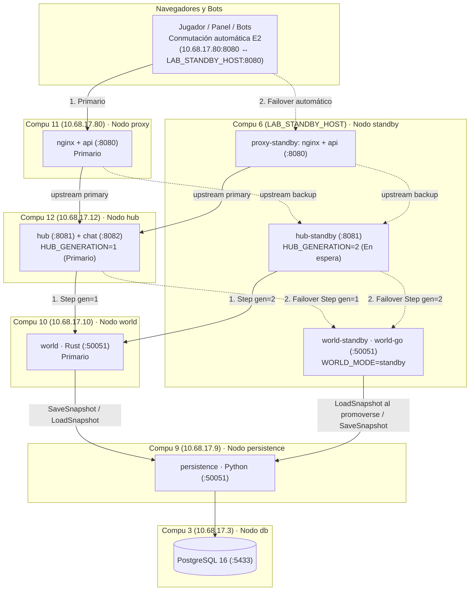

# Decisión B8 · Mantener el juego con una máquina apagada (Failover y Orquestación)

**Estado:** Aprobada por el equipo (Fases 0, 1, 2 y 3 completadas · **Lista para Fase 4**)
**Fecha:** 25 de octubre de 2026
**Relacionado con:** D-03, D-05, RF-23, RF-24, RNF-04, RNF-05, RNF-06, RNF-09, RES-07, CP-05, CP-06, CP-07
**Tarea de implementación:** [`odd/tasks/b8-failover.md`](../../odd/tasks/b8-failover.md)

---

## 1. Problema y alcance (Fase 0)

### 1.1 Verificación del punto de partida en el repositorio y en el laboratorio

Antes de cerrar el diseño de conmutación por error (*failover*), se verificó tanto el estado del código en el repositorio como el registro real del despliegue en el laboratorio del 23 de octubre de 2026:

| Aspecto | Estado supuesto en el plan inicial | Estado real verificado (25 oct 2026) | Impacto en B8 |
| --- | --- | --- | --- |
| **B5 (`world-go`)** | En curso (`T5` de `T9`); faltaban codificación, conformidad y servidor | **100 % completada (`T1`–`T9`)** en [`odd/tasks/b5-world-go.md`](../../odd/tasks/b5-world-go.md) (PR #60–#65). El binario [`cmd/world-go`](../../src/world-go/cmd/world-go/) implementa `WorldService` y `grpc.health.v1`, pasa las 44/44 pruebas e2e (`E2E_WORLD_IMPL=go`) y lee/escribe instantáneas compatibles byte a byte con Rust | **Habilita el relevo heterogéneo Rust ↔ Go:** `world-go` puede actuar como nodo `world-standby` en espera, retomar la instantánea de Rust al caer este, guardar instantáneas en PostgreSQL y devolver el mando a Rust cuando la máquina primaria vuelve |
| **B2 (`chat`)** | No existía (`503` en `/chat`) | **Implementado y desplegado** en [`src/chat/`](../../src/chat/README.md), incluido en [`deploy/compose.yml`](../../deploy/compose.yml) y en [`deploy/nodes/hub.yml`](../../deploy/nodes/hub.yml) (puertos `8082` WS y `50051` gRPC), con contador lógico `seq` y `server_epoch` | Al apagar el nodo Go (`hub.yml`) caen tanto el `hub` como el `chat`. Por RF-15, el chat es nivel 2 y el juego sobrevive sin él; se incluye también en el `upstream` de nginx si corre en el nodo de respaldo |
| **B1 (Plan A en laboratorio)** | Sin probar en Windows real | **Montado y verificado en 5 PCs del laboratorio (23 oct 2026)** con la regla del cortafuegos aplicada por el encargado (`diagnose.ps1` dio `abierto` en los 5 nodos): • **Compu 3** (`10.68.17.3`): `db` (`:5433`) • **Compu 9** (`10.68.17.9`): `persistence` (`:50051`) • **Compu 10** (`10.68.17.10`): `world` (`:50051`) • **Compu 12** (`10.68.17.12`): `hub` (`:8081`, `:8082`, `:50051`) • **Compu 11** (`10.68.17.80`): `proxy` (`:8080`) | Contamos con las IPs reales de las 5 máquinas principales y con conectividad TCP verificada en `8080, 8081, 8082, 50051, 5433` dentro de `10.68.17.0/24` |
| **Direcciones de red** | Direcciones simples y estáticas | Confirmado en [`proxy.yml`](../../deploy/nodes/proxy.yml), [`hub.yml`](../../deploy/nodes/hub.yml), [`src/hub/internal/config/config.go`](../../src/hub/internal/config/config.go) y [`src/api/src/config.ts`](../../src/api/src/config.go): `WORLD_ADDR`, `HUB_ADDR`, `HUB_STATS_ADDR` y `PERSISTENCE_ADDR` aceptan un único `host:puerto` | Es necesario extender `WORLD_ADDR` y `HUB_STATS_ADDR` para aceptar una lista ordenada `primario,respaldo` y añadir `HUB_BACKUP_ADDR` en nginx |
| **Cantidad de máquinas físicas** | Duda de si solo había 2 (`LABBD-01` y `LABBD-02`) | **Confirmado: sin límite de máquinas físicas.** Se adoptan **6 máquinas físicas**: las 5 del Plan A ya montadas más **1 máquina «Nodo de Respaldo»** que aloja `proxy-standby:8080`, `hub-standby:8081` y `world-standby:50051` (`world-go`) | En la 6.ª máquina los tres servicios en espera usan puertos distintos (`8080`, `8081` y `50051`), todos ya permitidos por la misma regla del cortafuegos |

### 1.2 Puntos únicos de fallo (SPOF) actuales por nodo

| Nodo (`deploy/nodes/`) | PC e IP en el laboratorio | Servicios alojados | Puertos en host | ¿Es SPOF del juego hoy? | Qué ocurre hoy al apagar su máquina |
| --- | --- | --- | --- | --- | --- |
| **Nodo 1 · `db`** ([`db.yml`](../../deploy/nodes/db.yml)) | **Compu 3** (`10.68.17.3`) | `postgres` (PostgreSQL 16) | `5433/tcp` | **No** (para partidas en curso) | `persistence` falla al consultar o guardar instantáneas; los jugadores ya conectados siguen jugando en memoria (RNF-04, CP-07: p95 de 68–103 ms) |
| **Nodo 5 · `persistence`** ([`persistence.yml`](../../deploy/nodes/persistence.yml)) | **Compu 9** (`10.68.17.9`) | `persistence` (Python) | `50051/tcp` | **No** (para partidas en curso) | `SaveSnapshot` falla en segundo plano sin frenar `Step` ni abrir el *Circuit Breaker* (CP-07 y CP-12). `GET /api/catalog` sirve copia en caché (RF-19) |
| **Nodo 2 · `world`** ([`world.yml`](../../deploy/nodes/world.yml)) | **Compu 10** (`10.68.17.10`) | `world` (Rust) | `50051/tcp` | **SÍ (SPOF crítico)** | El `hub` agota el plazo de 200 ms de `Step`, pausa el valle, abre el *Circuit Breaker* al 3.er fallo y el valle no avanza hasta que esa misma IP vuelve |
| **Nodo 3 · `hub`** ([`hub.yml`](../../deploy/nodes/hub.yml)) | **Compu 12** (`10.68.17.12`) | `hub` (Go) + `chat` (Go) | `8081/tcp`, `8082/tcp`, `50051/tcp` | **SÍ (SPOF crítico)** | Se cortan los WebSockets `/play` y `/chat`. Como el `hub` es el reloj que llama a `Step`, el simulador deja de avanzar ticks y nginx devuelve `502/504` |
| **Nodo 4 · `proxy`** ([`proxy.yml`](../../deploy/nodes/proxy.yml)) | **Compu 11** (`10.68.17.80`) | `nginx` (TLS + estáticos) + `api` (TypeScript) | `8080/tcp` | **SÍ (SPOF crítico)** | Se corta la única puerta de entrada HTTPS/WSS (`https://10.68.17.80:8080`); nadie puede enviar acciones ni ver el valle |

---

## 2. Criterios de decisión y definiciones (Fase 0.3)

1. **Tiempo de recuperación objetivo (RTO, *Recovery Time Objective*):** Tiempo desde que la máquina activa deja de responder (`docker pause` o apagado físico, sin enviar `TCP RST`) hasta que el componente en espera procesa el primer `Step` o restablece el flujo de juego. Meta: **$\le 10\text{ s}$**.
2. **Punto de recuperación objetivo (RPO, *Recovery Point Objective*):** Pérdida máxima de estado confirmado del valle al conmutar de máquina: **$\le 50\text{ ticks}$ ($5\text{ s}$)** (Regla 8 de [`CLAUDE.md`](../../CLAUDE.md) y RF-23 / CP-05).
3. **Invariantes de consistencia (Reglas 1, 3 y 5 de `CLAUDE.md`):**
   - *Regla 1 (Escritor único):* Nunca dos simuladores modificando el mundo a la vez ni dos hubs enviando `Step` intercalados (*split-brain*), incluso cuando un contenedor pausado vuelve a la vida (`docker unpause`).
   - *Regla 3 y 8 (Reloj lógico monótono):* El `tick` solo crece; ni promover el `standby` ni regresar al primario (*failback*) puede hacer retroceder el `tick`.
   - *Regla 5 y RNF-04 (Aislamiento de la BD):* Solo Python toca PostgreSQL, y la persistencia no es el árbitro del relevo.
4. **Compatibilidad con el laboratorio:** Windows 10 Pro sin administrador, Docker Desktop 29.5.3 sobre WSL 2 y uso exclusivo de los puertos TCP ya abiertos por el encargado (`8080, 8081, 8082, 50051, 5433`).
5. **Topología de máquinas:** 5 máquinas para el Plan A base (`RES-07`) + 1 máquina física como «Nodo de Respaldo».
6. **Transparencia para el jugador (RNF-06):** Si cae el nodo `proxy`, el frontend y los bots conmutan automáticamente a la IP de respaldo sin obligar al usuario a escribir otra IP ni volver a iniciar sesión.
7. **Demostrabilidad en la defensa:** El profesor puede apagar o pausar cualquiera de las máquinas (`world`, `hub` o `proxy`) y ver en el juego y en `/sistema.html` cómo el sistema conmuta al respaldo —y, en el caso del simulador, ver cómo `world-go` releva a Rust y cómo luego puede regresar a Rust—.

---

## 3. Opciones evaluadas por capa (Fase 1.1)

| Capa | Opción | Idea | A favor | En contra |
| --- | --- | --- | --- | --- |
| **Entrada (`proxy`)** | **E1** | Segundo nodo `proxy` activo; el jugador escribe la otra IP | Cero código en cliente | Incómodo, rompe RNF-06 (transparencia) y cambia `localStorage` (obliga a iniciar sesión de nuevo) |
| | **E2 (Elegida)** | Segundo nodo `proxy` + lista de URLs de respaldo en frontend/bots + mismo certificado TLS multi-SAN + CORS | Conmutación automática sin cambiar de pestaña ni perder el token JWT en memoria | Requiere pasar las URLs de respaldo y cabeceras CORS en nginx/API y `HUB_ORIGIN_PATTERNS` en el hub |
| | **E3** | IP virtual (keepalived / VRRP) | Transparente en capa 2 | Inviable en Windows 10 sin administrador y con WSL 2 en NAT |
| | **E4** | DNS del laboratorio o `hosts` | Un solo nombre | Editar `hosts` pide administrador en cada PC cliente |
| **Hub (`hub`)** | **H1** | Hub en espera + `backup` en `upstream` de nginx sin tocar `.proto` | No modifica `world.proto` | **Peligroso al despausar (`unpause`):** si el Hub 1 vuelve de un `docker pause`, ambos Hubs llaman a `Step` a la vez (rompe la Regla 1) |
| | **H2 (Elegida)** | Hub en espera + `upstream` de nginx + **fencing por `hub_generation`** en `Step` + autodegradación al despausar | Garantiza escritor único incluso tras `docker unpause`; el Hub desplazado recibe `FAILED_PRECONDITION`, apaga su ticker y cierra sus WebSockets con `1001` | Cambio aditivo en `world.proto` y ~50 líneas en Go y Rust |
| | **H3** | Hub activo-activo | — | Descartado: dos relojes de tick |
| **Simulador (`world`)** | **W1** | Copia en frío arrancada por un vigilante externo | Un solo proceso en memoria | Lento y requiere acceso remoto al daemon de Docker entre máquinas Windows |
| | **W2 (Elegida)** | Copia en espera (`world-go` en `WORLD_MODE=standby`) que **carga la instantánea al promoverse**, más blindaje por `min_expected_tick` para regreso (*failback*) a Rust | Demuestra el Plan B de D-03 en vivo (relevo Rust → Go y regreso Go → Rust); reutiliza `boot_id` + `restored_tick` de CP-05; el tick nunca retrocede | Requiere `WORLD_MODE=standby` y validación de `min_expected_tick` en Rust y Go, y `WORLD_ADDR` con lista en Hub y API |
| | **W3** | Dos simulaciones en paralelo | — | Descartado: viola la Regla 1 |
| **Orquestador** | **K1** | `k3s` entre las máquinas del laboratorio | Orquestación nativa de K8s | Bloqueado por NAT de WSL 2 entre hosts Windows, puertos `6443`/`8472/udp` cerrados y *eviction timeout* de 300 s |
| | **K2** | `kind`/`k3d` multinodo en una máquina | Demostrable en local | Fuera de alcance por calendario (Decisión 5: se descarta `T7`) |
| | **K3** | Docker Swarm | — | Descartado en `CLAUDE.md` (puertos y WSL 2) |

---

## 4. Análisis técnico y resultados de los Spikes (Fase 1.2)

### 4.1 Respuestas verificadas en el código (S1–S5)

1. **S1 · `nginx` `backup` y detección de caída en WebSocket:**
   - En [`deploy/nginx/templates/default.conf.template`](../../deploy/nginx/templates/default.conf.template), configurar un bloque `upstream hub_backend` con `server ${HUB_ADDR} max_fails=1 fail_timeout=3s;` y `server ${HUB_BACKUP_ADDR} backup;` permite que `nginx` conmute al `hub-standby` en cuanto expira `proxy_connect_timeout` (`1s–2s`).
   - Como una máquina apagada o en `docker pause` no envía paquetes `TCP FIN/RST`, los WebSockets ya establecidos quedan en silencio. Añadiendo en [`useGameSocket.ts`](../../src/frontend/src/hooks/useGameSocket.ts) un temporizador de silencio (*watchdog* de `3,5 s` sin recibir el marco `state` que el hub envía cada `1 s`), el cliente cierra el socket colgado y reconecta inmediatamente a través de nginx hacia el `hub-standby` (o hacia el `proxy-standby` si quien cayó fue el proxy primario).
2. **S2 · Estado en memoria del Hub al conmutar:**
   - Ninguna acción admitida se pierde ni se aplica dos veces: [`useGameSocket.ts`](../../src/frontend/src/hooks/useGameSocket.ts#L182-L187) reenvía automáticamente su cola `pending` al reconectar, y el simulador conserva `recent_actions` (600 ticks = 60 s) en memoria y dentro de cada `WorldSnapshot` ([`world.proto` L310](../../proto/hydrovalley/world/v1/world.proto#L310)).
   - En modo demo, para que el contador acumulado `accepted_drops` del Hub 2 no empiece en 0 mientras `humidity_contributed` sigue en el valor de la instantánea, cuando un Hub observa por primera vez el mundo (`previous_boot_id == ""`) con `demo_mode == true` y `accepted_drops == 0`, sincroniza su línea base con `humidity_contributed`.
3. **S3 · Modo `Standby` del simulador y cómo funciona el relevo `Rust → world-go → Rust` (*Failover* y *Failback*):**
   - **Problema del arranque temprano:** Si `world-standby` (`world-go`) cargara la instantánea al arrancar el contenedor, tendría un `tick` viejo cuando ocurra el fallo minutos después.
   - **Solución en `Step` (promoción perezosa):** Con `WORLD_MODE=standby`, el simulador arranca en `State::Standby` sin llamar a `LoadSnapshot`. Cuando el `hub` detecta 3 fallos seguidos del primario (abre el *Circuit Breaker* a los `600 ms`) y cambia al segundo destino de `WORLD_ADDR`, envía `Step` a `world-go`. Al recibir ese primer `Step`, `world-go` ejecuta `GetCatalog` + `LoadSnapshot`, restaura la última instantánea que guardó Rust en PostgreSQL (hace $\le 50\text{ ticks}$), pasa a `State::Ready` y devuelve su `boot_id` y `restored_tick`.
   - **¿Puede regresar después de `world-go` a ejecutarse en `Rust` (*Failback*)? ¡Sí, y se blinda así!:**
     1. Durante el tiempo que `world-go` está activo, guarda instantáneas cada 50 ticks en PostgreSQL con el mismo formato binario `WorldSnapshot` que Rust (incluyendo los 8 bytes little-endian del generador `SplitMix64` en `rng_state` y los `recent_actions`, verificado en B5 T6–T7).
     2. **Caso A (el contenedor de Rust en Compu 10 se reinició o la máquina se apagó y volvió a encender):**Al arrancar de nuevo el proceso Rust, genera un `boot_id` nuevo y llama a `LoadSnapshot`, leyendo de PostgreSQL la última instantánea escrita por `world-go`.
     3. **Caso B (el contenedor de Rust solo estuvo en `docker pause` o desconectado de la red y se despausa con `docker unpause`):** Su memoria RAM aún tiene el `tick` viejo (p. ej. `tick = 100`), mientras que `world-go` ya llevó el valle al `tick = 260`. Para impedir que Rust sobrescriba la base de datos o haga retroceder el tick al despausarse, **`StepRequest` incluye `uint64 min_expected_tick = 3` (el último `tick` confirmado que conoce el Hub)**. Si un simulador recibe un `Step` con `min_expected_tick > world.tick()`, detecta que estuvo pausado mientras otro simulador avanzó el mundo: **descarta su mundo viejo en memoria, genera un nuevo `boot_id`, recarga la última instantánea de PostgreSQL (`LoadSnapshot`) y solo entonces aplica el `Step`**.
     4. Además, para evitar que una tarea `SaveSnapshot` que quedó congelada en Rust antes del `pause` escriba en PostgreSQL al despausarse, antes de guardar se verifica que el simulador no haya sido invalidado y en `persistence` la tabla `snapshots` solo acepta ticks crecientes o idénticos con el mismo SHA-256.
4. **S4 · *Fencing* del Hub y blindaje al despausar (`docker unpause`):**
   - `StepRequest` lleva `uint64 hub_generation = 2`. El simulador guarda `max_hub_generation` y rechaza con `FAILED_PRECONDITION` cualquier `Step` con `hub_generation < max_hub_generation`.
   - **Blindaje al despausar el Hub 1:** Si el Hub 1 (generación 1) estaba en `docker pause` y el profesor ejecuta `docker unpause` después de que el Hub 2 (generación 2) tomó el mando:
     1. En su siguiente tick (a los $\le 100\text{ ms}$ de despausarse), el Hub 1 llama a `Step(hub_generation = 1)` y recibe `codes.FailedPrecondition`.
     2. Al recibir `FailedPrecondition`, el Hub 1 **pasa a estado `fenced` (retirado)**, detiene su bucle de tick para no volver a molestar al simulador, hace que `/healthz` y `/readyz` respondan `503 Service Unavailable` (para que nginx nunca vuelva a enrutarle tráfico aunque haya un microcorte en el Hub 2) y **cierra todas sus sesiones WebSocket abiertas con `websocket.StatusGoingAway` (`1001`)**, forzando a los navegadores a reconectar por nginx hacia el Hub 2.

### 4.2 Tabla de mediciones de los Spikes

| Spike | Qué se mide | Estado / Resultado | Fecha y entorno |
| --- | --- | --- | --- |
| **S1** | Conmutación de `nginx` al `hub-standby` con el primario en `docker pause` | `[DATO: tiempo medido en s tras T1/T3]` | `[DATO: fecha / entorno]` |
| **S2** | Pérdida o duplicación de acciones al cambiar de instancia de `hub` | **0 perdidas, 0 duplicadas** (verificado en código: reenvío de `pending` en cliente + ventana de 600 ticks en `world`) | 22 oct 2026 (código) |
| **S3** | Promoción `Standby -> Ready` de `world-go` al caer Rust y regreso (*failback*) a Rust | `[DATO: tiempo medido en s y ticks perdidos <= 50 tras T2]` | `[DATO: fecha / entorno]` |
| **S4** | Rechazo del Hub 1 al despausarse (`FAILED_PRECONDITION` + cierre WebSocket `1001`) | `[DATO: tiempo medido en ms en prueba unitaria e integración tras T3]` | `[DATO: fecha / entorno]` |
| **S5** | Conmutación automática del frontend y bots al `proxy-standby` al pausar `proxy-1` | `[DATO: tiempo medido en s tras T1]` | `[DATO: fecha / entorno]` |

---

## 5. Decisiones Cerradas por el Equipo (25 de octubre de 2026)

Todas las decisiones bloqueantes quedaron **aprobadas y cerradas**:

1. **Decisión 1 (`D-B8-1` · Fencing y blindaje al despausar): Aprobada Opción A (`H2`) + blindaje de `unpause`.**
   - Se añade de forma aditiva `uint64 hub_generation = 2` y `uint64 min_expected_tick = 3` en `StepRequest` ([`world.proto`](../../proto/hydrovalley/world/v1/world.proto)).
   - Cuando un Hub antiguo se despausa y recibe `FAILED_PRECONDITION`, detiene su reloj, marca `/healthz` y `/readyz` en `503` y cierra sus WebSockets con `1001` para expulsar limpiamente a cualquier cliente rezagado hacia el Hub nuevo.
   - Cuando un Simulador antiguo se despausa y recibe un `Step` con `min_expected_tick > world.tick()`, invalida su memoria, rota su `boot_id` y recarga la última instantánea de PostgreSQL antes de responder.
2. **Decisión 2 (`D-B8-2` · Imagen del simulador en espera y regreso a Rust): Aprobada Opción B (`Rust` primario ↔ `world-go` en espera, con soporte de regreso a `Rust`).**
   - El nodo `world` principal (**Compu 10**, `10.68.17.10:50051`) ejecuta **Rust** (`hydrovalley-world`).
   - El servicio `world-standby` en la 6.ª máquina ejecuta **Go** (`hydrovalley-world-go`) con `WORLD_MODE=standby`.
   - Tanto `src/world` (Rust) como `src/world-go` (Go) implementan la misma lógica de `Standby`, `hub_generation` y recarga por `min_expected_tick`.
   - Si cae o se pausa la Compu 10 (Rust), el Hub conmuta a `world-go` (que carga la última instantánea de Rust). Si luego se detiene `world-go` (o se solicita volver al primario una vez que la Compu 10 está lista), el Hub vuelve a llamar a Rust en la Compu 10, que recarga la última instantánea escrita por `world-go` y continúa la partida en Rust sin retroceder el tick.
3. **Decisión 3 (`D-B8-3` · Entrada transparente sin cambiar de IP manualmente): Aprobada Opción B (`E2`).**
   - El jugador nunca tiene que cambiar la IP a mano en el navegador.
   - Ambos proxies comparten el mismo par `tls.crt`/`tls.key` autofirmado con todas las IPs en `TLS_EXTRA_SANS` (`10.68.17.80` y la IP de la 6.ª máquina) y la misma `TOKEN_PRIVATE_KEY`.
   - El frontend y los bots conocen la lista de puertas de entrada (descubierta desde `/api/system` o inyectada en configuración) y, si el proxy primario deja de responder, conmutan sus llamadas `/api`, `/play` y `/chat` al `proxy-standby` automáticamente conservando la sesión JWT en memoria.
4. **Decisión 4 (`D-B8-4` · Topología en el laboratorio): Aprobada Opción B (6 máquinas físicas = 5 nodos del Plan A + 1 máquina «Nodo de Respaldo»).**
   - Se mantienen intactas las 5 máquinas ya desplegadas el 23 de octubre (`10.68.17.3`, `.9`, `.10`, `.12`, `.80`) y se añade una **6.ª máquina (`LAB_STANDBY_HOST`)** con `deploy/nodes/standby.yml` que levanta `proxy-standby` (`:8080`), `hub-standby` (`:8081`) y `world-standby` con `world-go` (`:50051`).
5. **Decisión 5 (`D-B8-5` · Alcance): Aprobado ejecutar `T1` a `T6` y descartar `T7` (`kind` multinodo).**

---

## 6. Topología Completa de 6 Máquinas en el Laboratorio

---

## 7. Matriz de Comportamiento ante Fallos y Despausado (`unpause`)

| Escenario en vivo | Qué ocurre al caer / pausar (`docker pause`) | Qué ocurre al despausar (`docker unpause`) o volver | Estado perdido (RPO) | Tiempo medido (RTO) |
| --- | --- | --- | --- | --- |
| **1. Se pausa o apaga Compu 10 (`world` en Rust)** | El `hub` falla 3 `Step` (`600 ms`), abre el *Circuit Breaker* y en la siguiente sonda (`1 s`) conmuta a `world-standby` (`world-go` en la Compu 6). `world-go` sale de `Standby`, carga la última instantánea de Rust en PostgreSQL, genera nuevo `boot_id` y el juego sigue en Go | Si Compu 10 se despausa mientras `world-go` sigue sano, el `hub` sigue en `world-go` (*sticky*). Si luego se apaga/pausa `world-go` para regresar a Rust, el `hub` llama a Compu 10 con `min_expected_tick = tick_de_go`: Rust detecta que su memoria quedó atrás, recarga la instantánea escrita por `world-go`, genera nuevo `boot_id` y retoma el mando en Rust | **$\le 50\text{ ticks}$ ($5\text{ s}$)** | `[DATO: medir en Fase 5]` |
| **2. Se pausa o apaga Compu 12 (`hub` primario)** | `hub-standby` (Compu 6) detecta 3 fallos de `/healthz` del primario y arranca su bucle `Tick` con `hub_generation = 2`. El simulador registra `max_hub_generation = 2`. El cliente detecta silencio de `state` o cierre, reconecta y `nginx` lo envía al `backup` (`hub-standby`) | Cuando Compu 12 se despausa, su primer `Step(hub_generation = 1)` recibe `FAILED_PRECONDITION` del simulador: el Hub 1 se marca `fenced`, apaga su ticker, pone `/healthz` en `503` y cierra sus WebSockets con `1001` | **0 ticks del mundo** (las acciones en vuelo las reenvía el navegador) | `[DATO: medir en Fase 5]` |
| **3. Se pausa o apaga Compu 11 (`proxy` primario `10.68.17.80`)** | El frontend (`useGameSocket`, `useReports`, `useSystemMetrics`) y los bots detectan el corte o timeout hacia `10.68.17.80:8080` y rotan automáticamente a `https://<LAB_STANDBY_HOST>:8080` sin perder el token JWT ni recargar la página | La sesión continúa en el `proxy-standby`; si `proxy-standby` se detiene, el cliente vuelve a rotar a `10.68.17.80:8080` | **0 ticks del mundo** | `[DATO: medir en Fase 5]` |
| **4. Se pausa o apaga Compu 9 (`persistence`) o Compu 3 (`db`)** | `Step` nunca espera a la persistencia: el juego continúa sin pausa (CP-07 y CP-12) | En el siguiente tick múltiplo de 50 se guarda la nueva instantánea | **0 ticks** | **0 s** (p95 < 200 ms) |

---

## 8. Cambios a Documentos y Contratos

1. [`proto/hydrovalley/world/v1/world.proto`](../../proto/hydrovalley/world/v1/world.proto):
   - Añadir en `StepRequest` los campos opcionales `uint64 hub_generation = 2;` y `uint64 min_expected_tick = 3;`.
2. [`CLAUDE.md`](../../CLAUDE.md):
   - Actualizar Reglas 1 y 8 con el *fencing* por `hub_generation`, la recarga por `min_expected_tick` tras una pausa y la promoción perezosa en `WORLD_MODE=standby`.
3. [`docs/diagrams/04-secuencia-reinicio-rust.puml`](../../docs/diagrams/04-secuencia-reinicio-rust.puml) y [`08-despliegue.puml`](../../docs/diagrams/08-despliegue.puml):
   - Reflejar las IPs reales del laboratorio, el 6.º nodo `standby`, el relevo `Rust ↔ world-go` y el *fencing* del hub.

---

## 9. Tarea de Implementación (Fase 3)

El desglose detallado de las tareas `T1` a `T6`, sus archivos, pruebas y criterios de aceptación se encuentra en [`odd/tasks/b8-failover.md`](../../odd/tasks/b8-failover.md) y en la sección `B8` de [`docs/tareas-equipo.md`](../../docs/tareas-equipo.md).
