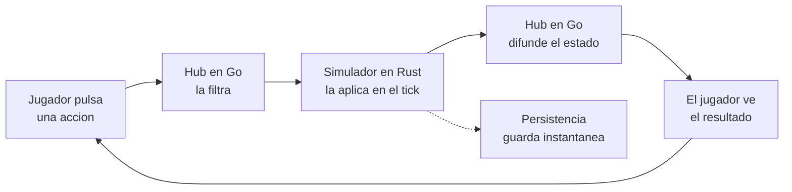
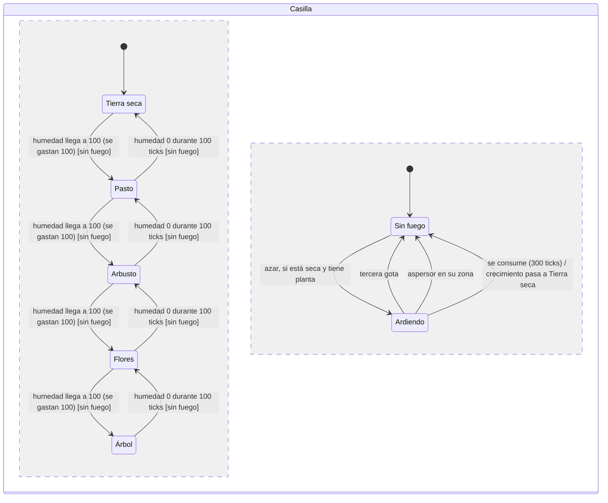
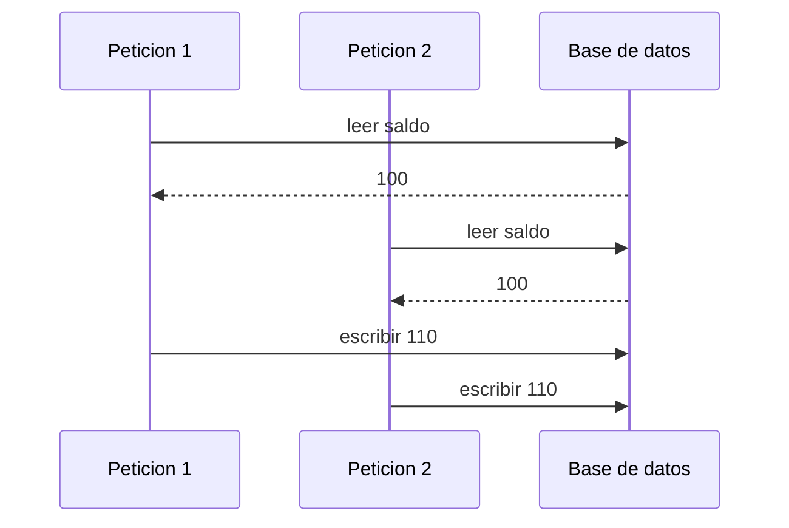
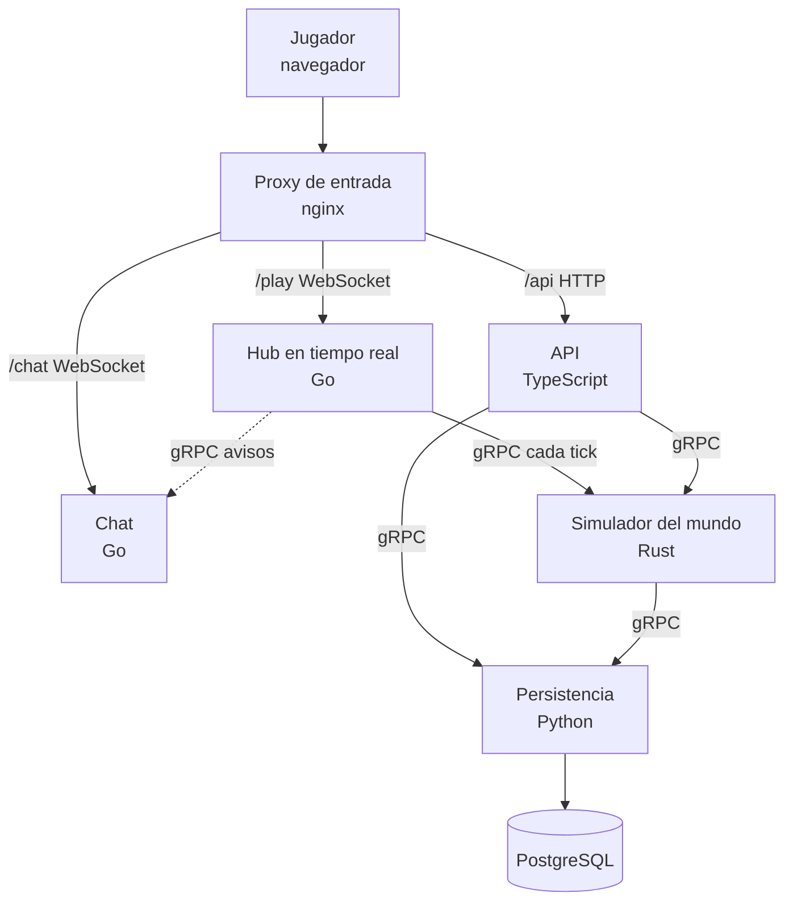
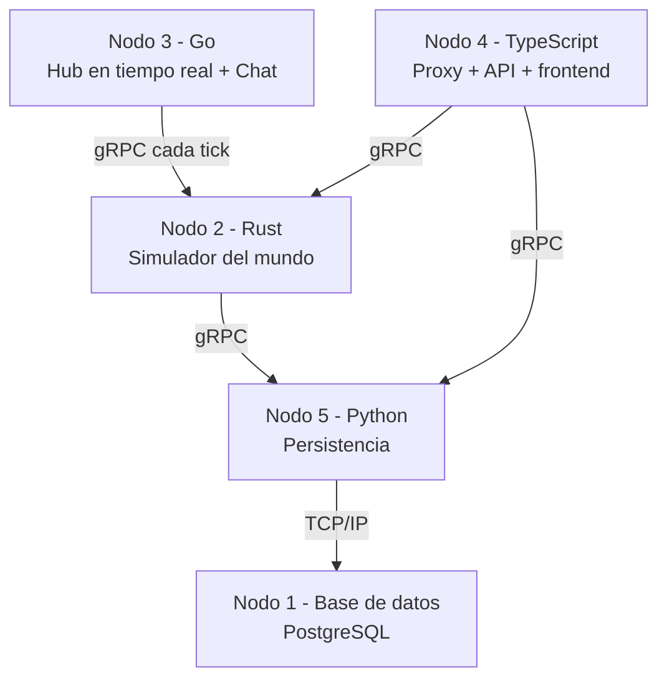
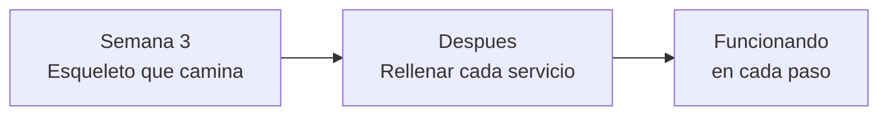
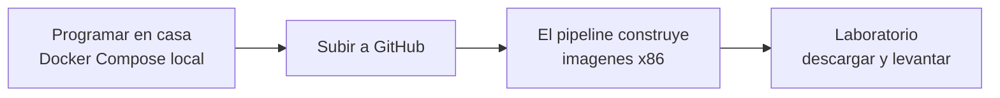

# Juego de las 3R del Agua — Documento Inicial

**Sistemas Distribuidos y Computación en la Nube · UCAB** · Sep 23, 2026 · @Ignacio

## Para qué sirve este documento

Este documento define **qué tiene que hacer el sistema** antes de que nadie escriba código, y deja por escrito las decisiones que ya tomamos y las que faltan.

Somos cuatro, y el proyecto exige cuatro lenguajes de programación distintos. Eso significa que cada quien va a ser dueño de una pieza que los demás no van a tocar a diario. **La única forma de que eso funcione es acordar primero cómo se hablan las piezas entre sí**, y después programarlas. Este documento es ese acuerdo.

Lo usamos así:

- Al empezar, para que los cuatro entendamos lo mismo por “el proyecto”.
- Durante el desarrollo, para consultar qué se supone que hace cada requisito y cómo se comprueba.
- Al final, como base del informe y de la defensa. Buena parte del contenido de aquí va directo allá.

## Qué vamos a construir, en cristiano

Un juego en línea sobre el cuidado del agua, del género clicker incremental e inspirado en Drop and Grow. Los jugadores sueltan gotas sobre un valle seco para que crezcan plantas; con las hojas que dan compran instalaciones de las 3R — reducir, reutilizar y reciclar — que riegan solas. El valle es uno y compartido: se seca, arde y reverdece mientras todos juegan a la vez. Hay un ranking global de quién más aportó.

Por dentro no es una aplicación, son **cinco servicios propios independientes (API, hub, chat, simulador y persistencia), más la base de datos, corriendo en máquinas distintas**, escritos en lenguajes distintos, que se coordinan para que el jugador vea una sola cosa coherente.

### Vocabulario que usamos todos igual

| Término | Qué es |
| --- | --- |
| **Acción** | Lo que hace un jugador: soltar una gota, comprar, colocar una instalación o aportar a una obra. Es la unidad básica del juego |
| **Farmear** | Hacer crecer el valle para ganar hojas: primero a mano, gota a gota, y después con instalaciones que riegan solas. Es la mecánica central |
| **Límite de gotas** | Máximo de gotas por segundo que el servidor acepta de un jugador: 15, más de lo que logra una persona. Frena a los autoclickers sin estropearle el juego a nadie |
| **Recursos** | Dos: el agua del depósito, que se gasta al regar y se recarga sola, y las hojas, que dan las plantas al crecer y se gastan en todo lo demás |
| **Mejora** | Compra única que mejora al jugador: gota más grande o depósito mayor. El árbol de mejoras completo queda para el nivel 2 |
| **Instalación** | Algo que se compra con hojas y se coloca en el valle para que trabaje solo: aspersores (Reutilizar), goteo (Reducir) y plantas de tratamiento (Reciclar). Cada una cuesta más que la anterior |
| **Obra comunitaria** | Una construcción en un punto fijo del valle que se paga entre todos. Al completarse, da una ventaja a todo el que juega (nivel 2) |
| **Mundo** | El valle compartido por todos. Vive en el servidor y sigue cambiando aunque nadie juegue: se seca, crece y arde |
| **Casilla** | Cada cuadro del valle. Tiene humedad, una etapa de crecimiento (tierra seca, pasto, arbusto, flores, árbol) y puede estar ardiendo |
| **Incendio** | Un fuego que aparece al azar en una casilla seca con planta y la va quemando. Se apaga con gotas. Que salte a las casillas vecinas queda para el nivel 2 |
| **Tick** | Cada paso de la simulación del mundo. Diez por segundo |
| **Instantánea** | Copia completa del mundo, guardada cada 50 ticks (5 s) para poder recuperarlo |
| **Servicio** | Uno de los programas independientes del sistema |
| **gRPC** | La forma en que los servicios se hablan entre ellos. Rápida y binaria |
| **Contrato** | La definición exacta de qué le puede pedir un servicio a otro. Vive en los archivos `.proto` |
| **Nodo** | Una máquina física donde corre uno o más servicios |

### El ciclo completo



La flecha punteada es importante: **el mundo se guarda por su cuenta, cada pocos segundos, sin hacer esperar al jugador.** Nada de escribir en la base de datos con cada clic: eso ahogaría el sistema en cuanto hubiera unas decenas de jugadores farmeando.

### Por qué un juego de farmeo y no otra cosa

Porque la mecánica genera justo los problemas que esta materia evalúa. No es decoración temática:

| Lo que provoca el farmeo | El problema que plantea |
| --- | --- |
| Muchas acciones pequeñas a la vez | **Concurrencia**: atender muchas peticiones a la vez sin bloquearse |
| Cada acción debe responder al instante | **Baja latencia**: por eso gRPC entre servicios y no HTTP |
| Los contadores tienen que cuadrar siempre | **Consistencia**: dos acciones simultáneas no pueden pisarse |
| El estado vive repartido en varias máquinas | **Sin memoria ni reloj compartidos**: el problema de fondo de la materia |

Si alguien pregunta por qué el proyecto pide tantas tecnologías distintas, esta tabla es la respuesta. **El agua es el tema; la concurrencia es el examen.**

## Dónde estamos hoy

Resumen honesto: **tenemos el enunciado y nada más.** Cero líneas de código, cero repositorios, ningún entorno montado. Eso está bien para el arranque, pero conviene ser explícitos para no confundir “ya lo tenemos claro” con “ya está hecho”.

### Lo que ya está definido

| Aspecto | Estado |
| --- | --- |
| Tema y mecánica del juego | 3R del agua: un clicker incremental cooperativo inspirado en *Drop and Grow* (D-01) |
| Restricciones técnicas | Las impone el enunciado: lenguajes, gRPC, Swagger, contenedores, CI/CD, UML (con notación lollipop en el de componentes) y despliegue en el laboratorio. Están en «Restricciones» (RES-01 a RES-07) |
| Requisito del informe | Al menos 5 patrones de diseño de la nube, en un máximo de 20 páginas |
| Valor | +5 puntos directos sobre la nota de la materia |
| Equipo | 4 personas |

### Lo que falta y depende de nosotros

- **Afinar las cifras del juego.** Ya hay cifras de arranque en D-01; falta ajustarlas jugando. Viven en el catálogo.
- **Confirmar la propuesta de D-02:** TypeScript y Python.
- **Quién hace qué.**
- **Aprobar la estructura del repositorio** propuesta en el plan de trabajo.
- **Los contratos `.proto`**, que son lo primero que hay que escribir.

### Lo que falta y depende del profesor

- **La fecha de entrega.** Resuelta: el proyecto se entrega en la semana 7 del curso (26 – 30 de octubre de 2026). Falta el día exacto: [DATO: día exacto de la entrega en la semana 7].

Dos cosas que ya sabemos y conviene dejar escritas:

- **Hay libertad para añadir funcionalidades.** El chat entra (D-04).
- **El reparto de máquinas del laboratorio sería: una para la base de datos, una para Rust, una para Go y dos para los otros lenguajes.** Cinco en total, que es justo la topología que teníamos planteada. Conviene confirmarlo con el profesor, porque viene de un compañero y no de él directamente.

Ese reparto dice algo importante: **el profesor le asignó una máquina propia a Rust.** Eso significa que espera ver a Rust haciendo trabajo de verdad, no un servicio decorativo. Es el motivo de la decisión D-03.

### Lo que hay que averiguar entre nosotros

Antes de repartir el trabajo hace falta saber quién tiene experiencia con qué: Go, Rust, gRPC, Docker, bases de datos, frontend. **El reparto de lenguajes debería seguir a esa conversación, no precederla.** Con solo cuatro personas y cuatro lenguajes, colocar a alguien en el lenguaje equivocado cuesta semanas.

## Decisiones

### D-01 · Las reglas del juego

Bloquea todo lo demás: sin reglas no hay requisitos, y sin requisitos no hay arquitectura.

#### Primero: qué tipo de juego

Se barajaron cuatro opciones: un *clicker*, un *tycoon*, una planta de reciclaje por turnos y un juego estilo *Overcooked*. La diferencia entre ellas no es estética: **cada una plantea un problema técnico distinto**, y eso es lo que decide.

|  | **Clicker cooperativo** | **Tycoon** | **Planta por turnos** | **Overcooked con personajes** |
| --- | --- | --- | --- | --- |
| Cómo se juega | Regar un valle compartido y automatizar el riego | Construir y mejorar una planta que funciona sola | Gestionar estaciones contra reloj, en equipo | Mover un personaje en tiempo real |
| ¿Se puede jugar con bots? | **Trivial** | Difícil | Muy difícil | Casi imposible |
| ¿Se ve que el estado queda exacto? | **Sí, con un número verificable** | A medias | Solo de forma anecdótica | No |
| Encaja con la arquitectura | Perfecto | Muy bien | Bien | Mal: exige otro modelo de red |
| Esfuerzo de frontend | Bajo | Medio | Medio-alto | Alto |
| Riesgo de no llegar | Bajo | Medio-bajo | Medio | **Alto** |

**Por qué no el Overcooked con personajes.** Cuando cada jugador mueve un personaje en tiempo real, el trabajo difícil deja de ser el sistema distribuido que se evalúa y pasa a ser el *netcode*: hacer que el movimiento se vea fluido aunque cada paso tenga que ir al servidor y volver. La referencia clásica sobre el tema, de [Gabriel Gambetta](https://www.gabrielgambetta.com/client-server-game-architecture.html), lo resume así: el cliente que solo envía comandos y espera la respuesta funciona para juegos pausados, pero en juegos de acción hacen falta cuatro técnicas adicionales para que no se note el retraso. Hasta el propio Overcooked 2, hecho por un estudio profesional, acumula [quejas recurrentes de lag y desincronización](https://steamcommunity.com/app/728880/discussions/1/2797250650688590310/) en su modo en línea.

#### La elegida: un clicker incremental cooperativo con un mundo compartido

**Elegimos el clicker, en su versión cooperativa.** No porque sea el más divertido, sino porque es el que mejor **demuestra** lo que se evalúa: concurrencia a escala, un estado que se mantiene exacto aunque muchos escriban a la vez, y tolerancia a fallos.

El argumento decisivo son los **bots**, jugadores simulados que se explican en la sección «Cómo se demuestra». Con cuatro o cinco personas jugando apenas hay concurrencia; hace falta más gente escribiendo a la vez, y ahí entran unos pocos bots y, mejor todavía, la clase entera jugando desde las máquinas del laboratorio. Solo en un clicker un bot es trivial. Uno que jugara bien un tycoon o la planta por turnos tendría que decidir qué hacer, y eso ya es inteligencia artificial.

**«Cooperativo» es la palabra importante.** Si cada jugador tuviera su propio contador, casi nunca habría dos escrituras sobre el mismo dato. Con un mundo común — todos riegan **el mismo** valle —, decenas de escrituras golpean el mismo estado, y ahí es donde el diseño de un solo escritor en Rust luce de verdad.

#### La base: *Drop and Grow*, en multijugador

La mecánica la tomamos casi entera de [*Drop and Grow*](https://store.steampowered.com/app/4268890/Drop_and_Grow/) (Shane Staller Games, 2026), un clicker incremental corto y relajante con un 91 % de reseñas positivas en Steam. Se hace clic sobre un mapa isométrico en pixel art, cae agua, y la tierra seca se va llenando de pasto, arbustos, flores y árboles. Las plantas dan recursos, y con ellos se mejora todo lo demás.

Copiar la mecánica de un juego que ya funciona es una decisión sensata en un proyecto universitario: nos ahorra diseñar y probar un juego desde cero, y el esfuerzo va a lo que se evalúa. Lo que no copiamos es el material: ni el nombre, ni el arte, ni la música.

|  | Qué |
| --- | --- |
| **Tomamos** | El mapa isométrico de casillas. El clic que suelta una gota sobre el mapa, con un radio que se mejora. Las etapas de crecimiento: tierra seca, pasto, arbusto, flores, árbol. Las plantas que dan recursos. El tono relajado. Si da tiempo, también su árbol de mejoras y el resumen de lo que pasó, que allí aparece al final de cada día |
| **Cambiamos** | Allí cada partida es un día que empieza y termina, y se juega solo. Aquí el valle es uno, permanente y compartido: no hay días que reinicien, y el resumen aparece al volver («mientras no estabas…») |
| **Añadimos** | Lo multijugador: todos riegan el mismo valle a la vez. La automatización, que varios jugadores le piden en los comentarios: aspersores y demás instalaciones de las 3R. Los incendios. El ranking. Y, si da tiempo, las obras comunitarias |

Y es todavía mejor para lo que se evalúa, porque **el mundo tiene vida propia**: se seca, crece y arde aunque nadie haga nada, mientras varios jugadores escriben sobre las mismas casillas a la vez. Es, literalmente, el problema de la materia: muchas cosas pasando al mismo tiempo sobre un estado compartido, con un resultado que tiene que ser exacto.

De paso, Rust se vuelve el corazón del juego: el valle es un *autómata celular*, en el que cada casilla cambia según su estado y el de sus vecinas en cada tick. D-03 explica por qué eso le da a Rust el papel que necesitaba.

#### Las reglas

La trampa es inventar un juego demasiado rico. **La nota no depende de que el juego sea divertido**, depende de que el sistema distribuido funcione. Un juego simple con arquitectura impecable saca más que un juego elaborado con arquitectura a medias. El incremental es la excepción que confirma la regla: su diversión sale de una tabla de números, no de código nuevo, y por eso cabe.

Propuesta mínima, suficiente para cumplir todo lo exigido:

| Elemento | Propuesta |
| --- | --- |
| El valle | Un mapa isométrico de 32 × 32 casillas, el mismo para todos. Cada casilla tiene humedad, una etapa de crecimiento y puede estar ardiendo |
| La gota | Clic sobre una casilla: gasta 1 litro de tu depósito y humedece esa casilla (con la mejora, también las de alrededor) |
| El depósito | Tu agua. Tiene capacidad limitada y se recarga sola con el tiempo. Es lo que marca el ritmo del juego |
| Crecer | Cuando una casilla acumula suficiente humedad, sube de etapa y gasta esa humedad. Quien soltó la gota que la hizo crecer gana hojas: más cuanto más alta la etapa. Si la hizo crecer una instalación, las hojas son para su dueño |
| Hojas | La moneda: se gastan en instalaciones y mejoras |
| Evaporación | Cada tick las casillas pierden un poco de humedad. Si una se queda seca (humedad 0) demasiado tiempo, su planta se marchita y baja una etapa |
| Instalaciones (las 3R) | **Reutilizar**: aspersor de agua gris, que riega solo las casillas de alrededor sin gastar tu depósito. **Reducir**: riego por goteo, que hace que las casillas de su zona se evaporen a la mitad. **Reciclar**: planta de tratamiento, que recarga tu depósito más rápido. Cada una cuesta un 15 % más que la anterior del mismo tipo. Como mucho una instalación por casilla |
| Mejoras | Dos para empezar: gota más grande y depósito mayor |
| Incendios | Aparecen al azar en casillas secas con planta y la queman poco a poco. Se apagan con tres gotas, de uno o de varios jugadores; quien suelta la tercera gana un bono. Un aspersor apaga los que caen en su zona. Si nadie lo apaga a tiempo, el fuego se consume y la casilla vuelve a tierra seca |
| Límite de gotas | 15 gotas por segundo por jugador. Lo que pase de ahí se rechaza |
| Competencia | Ranking de quién más ha hecho crecer el valle, medido en hojas ganadas |
| Modo demo | Sin evaporación ni incendios; la gota es gratis, de una sola casilla y suma 1 de humedad, para que el total se pueda verificar a ojo |
| **Si da tiempo** | Que el fuego salte a las casillas vecinas. Las obras comunitarias. El resumen al volver. El árbol de mejoras completo. Nuevos biomas. Todo está en el nivel 2 del plan de trabajo |

Estas reglas generan concurrencia real, estado compartido y necesidad de consistencia: las tres cosas que se evalúan. **Una vez acordadas, se congelan.** Cada cambio posterior arrastra requisitos, contratos y código de cuatro personas.

Lo que se congela son las reglas, no las cifras. Cuánto cuesta cada instalación o cuánto produce vive en el catálogo y se ajusta jugando, sin tocar código.

#### Cómo se ve

Una sola pantalla, sin menús que recorrer:

| Zona | Qué muestra |
| --- | --- |
| Centro: el valle | El mapa isométrico, el mismo para todos. La tierra se oscurece con la humedad, las plantas crecen, el humo marca los incendios, y se ve cómo cambia lo que riegan los demás |
| Arriba | Tu depósito de agua, como una barra que se vacía y se rellena, y tus hojas |
| Derecha | La tienda de instalaciones y las mejoras |
| Abajo | Lo que hay en la casilla elegida (y, en el nivel 2, la obra comunitaria con su barra de progreso) |
| Izquierda | El ranking, los avisos («¡fuego al noreste!») y, si llegamos, el chat |

#### Cómo avanza

1. **A mano.** Los primeros minutos se juega soltando gotas. El depósito se vacía rápido y hay que esperar a que se recargue, así que elegir dónde regar importa.
2. **La primera automatización.** Con las primeras hojas se compra un aspersor y se coloca junto a lo que ya creció. Desde ahí, esa zona se riega sola.
3. **La producción manda.** Goteo para que no se seque, plantas de tratamiento para tener más agua, más aspersores. Hacer clic importa menos que decidir qué comprar y dónde ponerlo.
4. **Defender.** Los incendios obligan a volver a mirar el mapa. En el nivel 2, las obras comunitarias proponen además gastar en lo común.

Cifras de arranque, para empezar a probar. Todas son valores iniciales: viven en `catalog/` y se ajustan jugando, sin tocar código:

| Qué | Precio inicial | Efecto |
| --- | --- | --- |
| Gota | 1 L del depósito | +25 de humedad en su casilla |
| Depósito | — | 20 L; se recarga 1 L cada 2 s |
| Crecer | — | Cada etapa pide 100 de humedad, que se gastan al subir, y da 1, 2, 4 u 8 hojas (pasto, arbusto, flores, árbol). En árbol, la humedad no pasa de 100 |
| Evaporación | — | −2 de humedad por segundo en cada casilla. Con humedad 0 durante 100 ticks (10 s), la casilla se marchita y baja una etapa |
| Aspersor de agua gris (Reutilizar) | 10 hojas | +25 de humedad a 3 × 3 casillas cada 2 s |
| Riego por goteo (Reducir) | 25 hojas | Evaporación a la mitad en 5 × 5 casillas |
| Planta de tratamiento (Reciclar) | 40 hojas | +1 L extra de recarga cada 2 s |
| Gota más grande (mejora) | 30 hojas | La gota humedece 3 × 3 casillas |
| Depósito mayor (mejora) | 20 hojas | +10 L de capacidad del depósito |
| Incendio | — | Se apaga con 3 gotas de cualquier jugador, contadas mientras arde, o con un aspersor cuya zona lo cubra; quien suelta la tercera gana 5 hojas. Mientras arde, la casilla no crece ni se seca. Si no se apaga en 300 ticks (30 s), se consume y la casilla vuelve a tierra seca |

#### Los estados de una casilla

Cada casilla es una pequeña máquina de estados con dos regiones que avanzan a la vez: el crecimiento y el fuego.



Es la idea de las regiones ortogonales de los statecharts de Harel: las dos partes cambian por su cuenta, pero se tocan en dos puntos. Mientras la casilla arde, la región de crecimiento queda congelada: no sube ni baja de etapa, y el contador de ticks con humedad 0 (`dry_ticks`) no avanza. La evaporación sigue bajando la humedad; solo la etapa queda fija. Las gotas que caen sobre ella siguen sumando a la humedad aportada y cuentan para apagarla. Y el fuego siempre se resuelve: con la tercera gota, con un aspersor o consumiéndose a los 300 ticks; en este último caso la región de crecimiento vuelve a tierra seca, esté en la etapa que esté. En árbol la humedad no pasa de 100.

#### Una partida de ejemplo

**Ana, el primer minuto.** Entra y ve el valle casi entero seco. Hay manchas verdes donde otros ya regaron, y una columna de humo al noreste. Su depósito tiene 20 litros. Suelta una gota sobre una casilla junto al río y la tierra se oscurece; a la cuarta gota brota pasto y gana 1 hoja. Con el depósito lleno le alcanza para cinco casillas de pasto. Espera a que se recargue y sigue. Al minuto tiene 12 hojas y compra su primer aspersor, que coloca en medio de su pasto. Desde ahí esas nueve casillas se riegan solas: al rato son arbustos, y cada una que crece le da hojas.

**Minuto 6: fuego.** Aparece un aviso: «¡Fuego al noreste!». Un arbusto seco a pocas casillas de su zona está ardiendo. Beto y Caro, que acaban de entrar, también lo ven. Los tres sueltan gotas sobre esa casilla en el mismo segundo. Rust las aplica en orden de llegada, y la tercera, la que apaga el fuego, es de Caro: se lleva el bono. Las gotas de Ana y Beto no se pierden, porque humedecieron la casilla. Si nadie hubiera llegado, el arbusto habría ardido hasta quedar en tierra seca.

**Minuto 12: la obra (si da tiempo).** Junto al río hay una obra comunitaria, un estanque que frena los incendios cercanos. Pide 500 hojas y ya lleva 320. Ana aporta 80 y Beto 60: faltan 40. Caro y Beto pulsan «Aportar 50» a la vez, y los dos comandos caen en el mismo tick:

- Caro llega primero. Se le cobran solo los 40 que faltaban, y la obra se completa.
- Beto llega después. La obra ya está completa y su aporte se rechaza sin cobrarle nada.

Nadie pierde una hoja, y el estanque aparece en las tres pantallas en la misma actualización.

**Al día siguiente.** Ana vuelve y el valle sigue ahí: sus aspersores funcionaron hasta 2 horas después de su última acción y luego se pararon hasta que volviera. Si da tiempo, verá además un resumen como el que *Drop and Grow* muestra al final de cada día: «Mientras no estabas, tus aspersores hicieron crecer 38 casillas y apagaron un incendio».

#### Lo que pasa por dentro con una gota de Ana

1. El navegador envía `{"type": "drop", "x": 14, "y": 9, "action_id": "…"}` por la conexión en vivo.
2. El proxy lo pasa al hub. La goroutine de Ana comprueba la sesión, que el `action_id` es nuevo y que no pasa de 15 gotas por segundo. Si la rechaza, le responde al instante: `{"type": "result", "action_id": "…", "status": "duplicate"}` (o `rate_limited`, `paused`, `forbidden`). Si el `action_id` ya está pendiente (en la cola o en curso), el reenvío se ignora: el resultado final llegará.
3. La gota espera en la cola del tick. Cada 100 ms, el hub llama a `Step` en Rust con todos los comandos admitidos.
4. Rust aplica los comandos en orden y después avanza el valle un paso: cobra el litro, suma humedad, hace crecer lo que toque y reparte hojas, riega con los aspersores, evapora y enciende incendios.
5. Justo después de cada `Step`, el hub envía el resultado final de cada comando (`applied`, `duplicate` o `rejected`) solo a los jugadores que tenían comandos en ese tick; si un comando pasa más de 30 s en la cola, el hub lo descarta y responde `expired`. El navegador muestra la gota como pendiente hasta ese resultado: trata `duplicate` como `applied` (la acción ya estaba aplicada), y muestra `rejected` y `expired` como fallos. Y una vez por segundo envía a cada navegador el estado del valle y el de su jugador. El navegador anima la barra del depósito hasta el siguiente mensaje.

En modo demo esto regala una comprobación de consistencia. Rust lleva un contador de la **humedad aportada** por las gotas en todo el valle (`humidity_contributed` en el código): solo crece, y ni el crecimiento, ni la evaporación, ni los incendios lo tocan. Como en modo demo cada gota suma 1, **la humedad aportada tiene que ser igual al número de gotas aceptadas que cuenta el hub.** El hub las cuenta solo a partir de los resultados `applied` de `Step`, no al admitirlas, así que un comando descartado o caducado nunca entra en la cuenta. Son dos contadores que viven en sitios distintos y tienen que coincidir.

#### Lo que cambia por dentro

| Tema | Qué hacemos |
| --- | --- |
| El azar de los incendios | Solo lo decide Rust, con un generador de números con semilla que se guarda en la instantánea. Así, al recuperar el mundo tras un fallo, el azar sigue exactamente donde iba; y en las pruebas, la misma semilla y los mismos comandos dan siempre el mismo valle |
| El ritmo | Lo marca el depósito, no una espera entre clics: un clicker con espera no es un clicker. El límite de 15 gotas por segundo frena a los autoclickers, y *Rate Limiting* se sigue viendo en vivo |
| Cuánto se envía | El valle son 1.024 casillas con unos pocos datos cada una: un par de kilobytes por segundo por jugador. Los bots pueden pedir no recibir el mapa |
| Entre mensajes | El navegador anima la barra y las hojas hasta la siguiente actualización, que lo corrige. Es solo visual: el número que vale es el del servidor |
| Desconectado | Los aspersores siguen regando hasta 2 horas después de la última acción del jugador; luego se paran hasta que vuelva. Sin ese tope, quien se ausente un fin de semana volvería con una fortuna que rompe el equilibrio. Basta un dato por jugador: el tick de su última acción |

#### ¿Isométrico? Sí, con salida de emergencia

Es lo que le da el encanto a *Drop and Grow*. Es viable porque Phaser soporta mapas isométricos hechos con Tiled, incluida la conversión de un clic en pantalla a una casilla, y porque Kenney tiene packs isométricos con licencia CC0.

Lo importante es que **el servidor no sabe cómo se dibuja el valle**: para Rust, una casilla es una coordenada. Por eso la salida de emergencia es barata. Si al final de la semana 4 el clic sobre una casilla isométrica no funciona bien, se pasa a vista cenital con Tiny Town, sin tocar nada fuera del frontend.

### D-02 · Qué dos lenguajes de los tres

| Opción | A favor | En contra |
| --- | --- | --- |
| **TypeScript + Python** | TS sirve también para el frontend, así una persona cubre dos frentes con un solo lenguaje. Python es el más rápido de escribir | Ninguno de los dos “luce empresarial”, si eso pesara |
| TypeScript + Java | Java contrasta bien y es el típico servicio de negocio | Es el más lento de escribir y de empaquetar |
| Java + Python | Combinación clásica de backend | Deja el frontend sin lenguaje compartido |

**Propuesta: TypeScript + Python.** El frontend va a existir igual, así que TypeScript se paga solo. Y con cuatro personas cubriendo cuatro lenguajes, el tiempo de escritura es el recurso escaso: Python es donde menos se gasta.

#### ¿Y si usamos los tres?

Surgió la idea de pedir permiso para usar TypeScript, Java y Python a la vez. **No conviene, y la razón es aritmética.**

Usar los tres nos deja con **cinco lenguajes para cuatro personas**. Cada lenguaje añadido no trae solo su sintaxis: trae su cadena de compilación, su forma de generar el código gRPC desde los `.proto`, su imagen de contenedor, su gestión de dependencias y su manera particular de fallar. Eso es coste fijo, se use mucho o poco ese servicio.

Y no resuelve ningún problema que tengamos. No nos falta un sitio donde poner código; nos falta tiempo para escribirlo.

**Recomendación: quedarnos en dos y no hacer la pregunta.** El esfuerzo de pedir permiso se aprovecha mejor en las confirmaciones que sí afectan al plan.

### D-03 · Qué hace Rust de verdad

**El planteamiento inicial le daba a Rust un papel demasiado débil, y hay que corregirlo.**

La idea era que Rust recalculara el ranking global. Pero ordenar unos cientos de jugadores por lo que aportaron es una operación trivial: la hace cualquier lenguaje en milisegundos, y la base de datos la resuelve sola. Poner Rust ahí es ponerlo de adorno, y eso se nota en la defensa: la pregunta «pero ¿por qué Rust?» no tendría buena respuesta.

Descartarlo tampoco es opción. El profesor insistió en que sean los dos, y además le asignó una máquina propia en el laboratorio. Así que la salida correcta no es quitarlo: es **darle trabajo que solo él debería hacer**.

**Go para lo que espera, Rust para lo que calcula.** No es necesidad sino reparto de papeles. Qué hace cada uno en concreto está en «Cómo se reparten Go y Rust», en la sección de arquitectura.

> **Advertencia para la defensa: no digan que Rust es necesario por las pausas del recolector de basura de Go.** Es un argumento que circula mucho y está desactualizado. Desde Go 1.8 esas pausas están por debajo del milisegundo, y el objetivo declarado del equipo de Go es de 500 microsegundos por ciclo ([fuente oficial](https://go.dev/blog/ismmkeynote)). Nuestro tick dura 100 ms: doscientas veces más. Si el profesor pregunta «¿por qué Rust?», la respuesta honesta es de **reparto de papeles** respaldado por una medición, no de necesidad técnica.

#### La propuesta: Rust simula el valle

El juego deja de ser solo contadores por jugador y pasa a tener **un mundo compartido**: un valle de casillas, cada una con su humedad, su planta y, a veces, su fuego.

Rust ejecuta esa simulación diez veces por segundo y en cada paso calcula, casilla por casilla, la evaporación, el crecimiento, el riego de los aspersores y los incendios. Las instalaciones que compran los jugadores no suman puntos en el vacío: **modifican parámetros de esa simulación**, como se detalla en la fila «Instalaciones» de las reglas de D-01.

Y el estado del valle determina la recompensa: cada casilla que crece da hojas a quien la hizo crecer. El ranking sale de ahí, ya no es una lista ordenada a mano.

#### Por qué esto mejora todos los frentes

- **Le da a Rust un papel con sentido.** Un bucle de cómputo sobre todas las casillas del valle, diez veces por segundo, es el tipo de trabajo para el que Rust se diseñó. Ojo: no es que Go no pudiera hacerlo — a esta escala cualquiera de los dos va sobrado. Es que así cada lenguaje hace aquello en lo que destaca, y la comparativa lo demuestra con números.
- **Es medible.** «Cada paso del valle tarda tantos microsegundos» se enseña con números, no con adjetivos. El valle del juego son 1.024 casillas, poco para que se note diferencia entre lenguajes; para la comparativa se agranda un valle de prueba, por ejemplo a 256 × 256, hasta que la diferencia se vea.
- **Encaja con el tema.** Es literalmente el sistema de agua del que va el juego. Deja de ser una aplicación de contadores con nombre ecológico.
- **Añade un problema distribuido de verdad.** El mundo es único y compartido: todos actúan sobre el mismo valle. Eso es estado compartido real, no un contador por persona.
- **No complica la arquitectura.** Sigue siendo un servicio con su contrato. Lo que cambia es que ahora ese servicio hace algo que importa.

#### La jugada que cierra la defensa

Implementar **el mismo paso de simulación en Go y en Rust**, medir los dos y llevar el gráfico al informe.

Cuesta una tarde y cambia por completo la respuesta a «¿por qué Rust?». Se pasa de «porque nos lo pidieron» a «porque en esta carga concreta es N veces más rápido, y aquí está la medición». Pocos equipos llegan con eso.

#### Si el tiempo aprieta

Versión mínima defendible: el valle de 32 × 32 casillas con gotas, evaporación y crecimiento, y un paso cada 100 milisegundos. Aspersores, goteo e incendios se suman encima. Sigue siendo una simulación de verdad, sigue justificando Rust, y cabe en una semana de trabajo de una persona.

**Punto de control, acordado desde ya:** si al terminar la semana 3 el simulador en Rust no responde a una llamada de Go, Rust pasa a calcular solo el ranking, y el mundo lo lleva Go con la versión del tick que íbamos a escribir de todos modos para la comparativa. Decidirlo ahora, con calma, evita tener que discutirlo con prisas.

Lo que no hay que hacer es dejar a Rust ordenando una lista.

### D-04 · El chat

**Entra.** El profesor no pone problema a funcionalidades extra, y esta es la mejor que podíamos añadir — no por el juego, sino por la materia.

Un chat obliga a resolver el problema central de la materia en su forma más pura: **si dos personas escriben a la vez desde máquinas distintas, ¿en qué orden se muestran los mensajes?** Ordenar por la hora de cada servidor no funciona, porque los relojes se desvían. La solución es un contador lógico, y poder explicar eso en la defensa vale mucho.

El servicio de chat es el único punto que asigna a cada mensaje un **número de secuencia creciente** (un contador lógico), y eso fija el mismo orden para todos (RF-14, CP-09). Los navegadores reciben los mensajes en vivo por el WebSocket `/chat` del propio servicio, que es donde vive el Publisher-Subscriber; por eso no hay un `Subscribe` en gRPC. `ListMessages` sirve para ponerse al día tras una reconexión. Por gRPC solo lo usa el hub, que publica con `SendMessage` avisos del sistema como las alertas de fuego. Los bots de CP-09 entran como cualquier jugador, por el WebSocket `/chat`. Guarda en memoria los últimos 200 mensajes, sin base de datos: es nivel 2 y el juego tiene que sobrevivir sin él (RF-15).

Además encaja sin estorbar:

- Refuerza el patrón **Publisher-Subscriber**, uno de los cinco del informe.
- Da más justificación para Go: muchas conexiones abiertas a la vez.
- Es un servicio propio y bien acotado, que se puede apagar sin afectar al juego.

**Condición: como módulo aparte.** Si el chat se cae, el juego sigue (RF-15). Así es una mejora que suma en vez de un riesgo que arrastra.

### D-05 · Dónde se despliega

| Opción | A favor | En contra |
| --- | --- | --- |
| **Docker Compose** | Se levanta con un comando, funciona siempre, no cuesta nada | Como “nativo en la nube” es defendible pero modesto |
| Kubernetes local (k3s, kind) | Orquestación de verdad, se ve serio en la defensa | Curva de aprendizaje real; puede comerse una semana |
| Nube pública gratuita | Es literalmente “nativo en la nube” | Límites, pagos y riesgo de que falle el día de la demo |

**Propuesta: Docker Compose primero, y subir a Kubernetes solo si el sistema ya funciona.** El orden importa. Un Kubernetes precioso sin servicios que desplegar no vale nada, y el despliegue previsto es sobre las máquinas del laboratorio, no sobre una nube externa.

### D-06 · La base de datos

**PostgreSQL, en su propio nodo.** Es lo que se planteó en clase y no hay motivo para discutirlo. Una sola base de datos, y **un solo servicio que la toca**: el de persistencia en Python. El resto le pide lo que necesita por gRPC. Qué se guarda y cómo está explicado en la sección de arquitectura.

## Requisitos funcionales

Cada requisito dice **qué** tiene que pasar, no **cómo** se programa, y trae la prueba concreta que permite decir “esto ya está”. Si no se puede probar, no es un requisito.

### Jugadores y sesión

| ID | Requisito | Cómo se comprueba |
| --- | --- | --- |
| RF-01 | El sistema debe permitir que un usuario se registre y entre con sus credenciales | Se crea una cuenta y se entra con ella desde otro navegador |
| RF-02 | El sistema debe mantener la sesión del jugador entre peticiones y entre servicios mientras su token firmado siga vigente | Se recarga la página y el jugador sigue dentro |
| RF-03 | El sistema debe mostrar al jugador su agua, sus hojas y sus mejoras actualizadas al menos una vez por segundo | Lo que muestra la pantalla coincide con el estado del simulador |

### Mecánica del juego

| ID | Requisito | Cómo se comprueba |
| --- | --- | --- |
| RF-04 | El jugador debe poder soltar gotas sobre cualquier casilla del valle, y comprar y colocar instalaciones de las tres familias de las 3R, siempre que le alcance el agua o las hojas | Fuera del modo demo, una gota gasta 1 L del depósito y suma humedad; al pasar el umbral, la casilla crece y el jugador gana hojas |
| RF-05 | El sistema debe rechazar las gotas de un jugador que pasen de 15 por segundo | Un bot envía 50 gotas por segundo y solo se aceptan 15 |
| RF-06 | El sistema debe rechazar con un error claro cualquier acción inválida, sin interrumpir el servicio | Se envía una acción inventada y responde con un error claro |
| RF-07 | El jugador debe poder gastar hojas en instalaciones y mejoras, y el sistema debe subir un 15 % el precio de cada instalación tras cada compra del mismo tipo | Se compra un aspersor: bajan las hojas, y el siguiente cuesta un 15 % más |
| RF-08 | **El sistema debe aplicar todas las acciones simultáneas de un mismo jugador sin duplicar ni perder recursos** | Se lanzan 100 acciones a la vez y el total final es exacto |
| RF-09 | El sistema debe aplicar una sola vez una acción que llegue repetida con el mismo identificador | Se repite la petición con el mismo identificador y el saldo no cambia |
| RF-25 | El sistema debe mantener trabajando las instalaciones de un jugador aunque no esté conectado, hasta 2 horas después de su última acción | Se coloca un aspersor, se cierra la pestaña y al volver sus casillas crecieron; pasadas 2 horas, el aspersor está parado |
| RF-26 | **El sistema debe aceptar aportes simultáneos de varios jugadores a una misma obra comunitaria, completarla una sola vez y no cobrar los aportes que lleguen después** (nivel 2) | Veinte bots aportan a la misma obra: se completa una vez, al que la completa solo se le cobra lo que faltaba, y los aportes que llegan después se rechazan sin cobrar |
| RF-27 | **El sistema debe mantener cuadradas las cuentas de cada jugador en todo momento: agua = recargada − gastada, y hojas = ganadas − gastadas** | Tras una prueba de carga con instalaciones encendidas, el sistema comprueba la igualdad para todos los jugadores |
| RF-28 | El sistema debe hacer evolucionar el valle en cada tick, con evaporación, crecimiento y marchitamiento, aunque nadie juegue | Se riega una casilla y se deja: pierde humedad al ritmo del catálogo y, seca demasiado tiempo, se marchita |
| RF-29 | **El sistema debe encender y apagar los incendios según reglas fijas, con un azar que decide solo el simulador a partir de una semilla** | Con la misma semilla y los mismos comandos, dos ejecuciones dan exactamente el mismo valle |
| RF-30 | **El sistema debe aplicar las gotas de varios jugadores sobre una misma casilla en el mismo tick sin perder ninguna** | Veinte bots sueltan gotas sobre la misma casilla en modo demo: la humedad aportada sube exactamente lo de las gotas aceptadas |

### Ranking y reportes

| ID | Requisito | Cómo se comprueba |
| --- | --- | --- |
| RF-10 | El sistema debe calcular un ranking global de quién más aportó al valle, medido en hojas ganadas | El orden entre jugadores es correcto |
| RF-11 | El sistema debe recalcular el ranking sin pausar el juego | Se recalcula mientras hay jugadores actuando y nadie nota pausas |
| RF-12 | El sistema debe entregar a pedido un reporte de las 3R por jugador y global | Los totales cuadran con las acciones ejecutadas |

### Chat

| ID | Requisito | Cómo se comprueba |
| --- | --- | --- |
| RF-13 | El jugador debe poder enviar mensajes a los demás jugadores conectados (nivel 2) | Dos navegadores distintos se ven los mensajes |
| RF-14 | El sistema debe mostrar los mensajes en el mismo orden a todos los jugadores (nivel 2) | Dos personas escriben a la vez y las dos pantallas coinciden |
| RF-15 | El sistema debe seguir atendiendo el juego aunque el chat no responda (nivel 2) | Se apaga el servicio de chat y las acciones siguen respondiendo |

### Administración

| ID | Requisito | Cómo se comprueba |
| --- | --- | --- |
| RF-31 | El administrador debe poder activar y desactivar el modo demo y reiniciar el valle; solo con rol de administrador en el token | Con un token sin ese rol, el comando se rechaza; con rol de administrador, el modo demo y el reinicio se aplican en el siguiente tick |

El panel de administración envía estos comandos por el mismo WebSocket `/play`, con su token de administrador. El hub solo los admite con ese rol, y entran en la cola del tick como cualquier comando: Rust los aplica en `Step`, así que el escritor único se mantiene. Reiniciar el valle devuelve el mundo a su estado inicial y pone a cero los contadores de las 3R y de RF-27, pero conserva las cuentas y **no reinicia el tick**, que es el reloj lógico y solo crece (Capa 4); cada reinicio incrementa la época (`epoch`) de las instantáneas, y los reportes por periodo usan solo las instantáneas posteriores al último reinicio. Las cuentas de administrador las crea la persistencia al arrancar, si no existen, a partir de las variables de entorno `ADMIN_USERNAME` y `ADMIN_PASSWORD_HASH`; `Register` crea siempre jugadores. La prueba de carga no se lanza desde la interfaz sino desde el contenedor de los bots (por ejemplo, `docker compose run bots load-test`); la cubren RNF-01, RNF-02 y CP-11.

### Tolerancia a fallos

| ID | Requisito | Cómo se comprueba |
| --- | --- | --- |
| RF-19 | El sistema debe seguir respondiendo con lo que pueda cuando un servicio secundario no responde | Se apaga el de reportes y el juego sigue |
| RF-23 | El sistema debe recuperar el mundo desde la última instantánea cuando el simulador se reinicia | Se detiene Rust a propósito; al volver, el mundo está donde estaba, con como mucho 5 s de pérdida mientras la persistencia responda (si una instantánea falla, la pérdida llega hasta la última guardada) |
| RF-24 | El sistema debe conservar el mundo y dejar que los jugadores se reconecten cuando el hub se reinicia | Se detiene Go; al reiniciarlo, el mundo está intacto en Rust y los jugadores retoman su sesión |

RF-16, RF-17 y RF-18 pasaron a ser restricciones (RES-01, RES-04 y RES-05), porque los impone el enunciado.

### Despliegue y automatización

| ID | Requisito | Cómo se comprueba |
| --- | --- | --- |
| RF-20 | El sistema completo debe levantarse con un solo comando en una máquina limpia | En una máquina limpia, un comando y queda operativo |
| RF-21 | El pipeline debe compilar, probar y empaquetar automáticamente cada cambio que se sube | Se sube un cambio y el pipeline corre solo |
| RF-22 | El pipeline debe rechazar el código que rompe las pruebas | Se sube un cambio roto a propósito y el pipeline lo rechaza |

**RF-08 y RF-09 son los requisitos estrella.** Son los únicos que demuestran de verdad que entendimos el problema: sin memoria compartida, dos peticiones simultáneas pueden leer el mismo valor y escribir una encima de la otra. Si la demo incluye lanzar cien acciones concurrentes y mostrar que el total cuadra exacto, eso vale más que cualquier otra cosa que enseñemos.

**Qué entra primero y qué se recorta** está en los dos niveles de alcance del plan de trabajo. Lo que nunca se recorta: RF-08, RF-09, RF-21 y la restricción RES-01.

## Requisitos no funcionales

No son cosas que el sistema haga, son condiciones que cumple mientras las hace. Aquí **valen tanto como los funcionales**: son lo que distingue un sistema distribuido de una aplicación normal partida en pedazos.

| ID | Requisito | Por qué está aquí |
| --- | --- | --- |
| RNF-01 | Rendimiento: el sistema debe atender al menos 100 acciones por segundo con 30 bots conectados, sin salirse de la latencia de RNF-02 | Es lo que justifica Go y sus goroutines |
| RNF-02 | Latencia: el 95 % de las acciones debe responder en menos de 200 ms | Es lo que justifica gRPC frente a HTTP tradicional |
| RNF-03 | El recálculo del ranking no debe hacer que las acciones pasen de los 200 ms de RNF-02 | Separa el trabajo pesado del camino crítico |
| RNF-04 | Disponibilidad: si cae un servicio secundario (chat, reportes o persistencia), las gotas deben seguir respondiendo en menos de 200 ms | Tolerancia a fallos |
| RNF-05 | Ningún servicio debe ordenar eventos comparando relojes de máquinas distintas; el orden lo da el número de tick | Los sistemas distribuidos no comparten reloj. Es el punto de partida de la materia |
| RNF-06 | Transparencia: el jugador debe usar una sola dirección y no ver nunca un error interno; si un servicio cae, ve un aviso | El profesor insistió en esto |
| RNF-07 | Cada servicio debe registrar sus eventos con un identificador de petición que permita seguir una acción de punta a punta | Sin esto, depurar entre cinco servicios es imposible |
| RNF-08 | Cada servicio debe exponer un punto de comprobación de salud | Es lo primero que se mira cuando algo falla |
| RNF-09 | El sistema debe arrancar aunque los servicios lo hagan en distinto orden, reintentando la conexión en vez de caerse | Un servicio no puede caerse porque otro tardó dos segundos más |
| RNF-10 | El sistema completo debe levantarse desde cero en menos de 5 minutos | Reproducibilidad y demo sin sustos |
| RNF-12 | Las contraseñas deben guardarse con un hash seguro y viajar solo por conexiones cifradas | Mínimo de seguridad exigible |
| RNF-13 | Ningún secreto debe vivir dentro del código ni del repositorio | Error clásico que cuesta puntos |

RNF-11 pasó a ser la restricción RES-03.

### Restricciones

Lo que impone el enunciado no es un atributo de calidad sino una restricción de diseño, así que va aparte:

| ID | Restricción | Cómo se comprueba |
| --- | --- | --- |
| RES-01 | Los servicios internos se comunican por gRPC (antes RF-16) | Se inspecciona el tráfico y se ve gRPC, no HTTP plano |
| RES-02 | Go y Rust son obligatorios, más dos lenguajes entre TypeScript, Java y Python (D-02) | Cada servicio está en el lenguaje que le toca |
| RES-03 | Cada servicio se empaqueta en su propio contenedor (antes RNF-11) | Un contenedor por servicio en el archivo de Docker Compose |
| RES-04 | Las APIs externas se documentan con Swagger/OpenAPI (antes RF-17) | La página de Swagger abre y permite probar cada endpoint |
| RES-05 | Los diagramas de componentes, despliegue y estados usan UML; el de componentes, con notación lollipop (antes RF-18) | El diagrama coincide con lo que expone el código |
| RES-06 | Hay un pipeline de CI/CD | Lo cubren RF-21 y RF-22 |
| RES-07 | El despliegue se hace en las máquinas del laboratorio: una para la base de datos, una para Rust, una para Go y dos para los otros lenguajes | El diagrama de despliegue y un ensayo en el laboratorio |

### Trazabilidad

Cada requerimiento sale de una necesidad concreta, se resuelve en un componente y se demuestra con una prueba. Los casos de prueba (CP) están en «Cómo evitamos perder o duplicar recursos»:

| Necesidad (origen) | Requerimientos | Dónde se resuelve | Cómo se prueba |
| --- | --- | --- | --- |
| Muchos jugadores escriben a la vez sobre el mismo valle | RF-08, RF-30, RNF-01, RNF-02 | Hub (Go) y simulador (Rust), escritor único | CP-01, CP-04, CP-11 |
| Reintentos de red y doble clic | RF-09 | Hub y simulador, con `action_id` | CP-02 |
| Autoclickers y trampas | RF-05, RF-06 | Hub: *Gatekeeper* y *Rate Limiting* | CP-03 |
| Que el mundo sobreviva a un reinicio | RF-23, RF-24 | Simulador y persistencia, con instantáneas | CP-05, CP-06, CP-12 |
| Que un servicio caído no tumbe el juego | RF-15, RF-19, RNF-04 | Hub: *Circuit Breaker* | CP-07 |
| Arranque en cualquier orden | RNF-09 | Todos los servicios: *Retry* | CP-08 |
| Orden sin reloj compartido | RF-14, RNF-05 | Chat y tick como reloj lógico | CP-09 |
| Azar reproducible | RF-29 | Simulador, con semilla en la instantánea | CP-10 |
| Un mundo que vive solo | RF-25, RF-28 | Simulador (el autómata del valle) | Prueba de RF-28 |
| Una economía que cuadra | RF-07, RF-27 | Simulador | Comprobación de RF-27 tras CP-11 |
| Operar la demo sin saltarse el escritor único | RF-31 | Hub (rol de administrador) y simulador (`Step`) | Prueba de RF-31 |
| Acceso seguro | RF-01, RF-02, RNF-12, RNF-13 | API (TypeScript) y persistencia (Python) | Pruebas de RF-01 y RF-02 |
| Despliegue repetible | RF-20, RF-21, RF-22, RNF-10 | Pipeline y Docker Compose | Prueba en máquina limpia |

### Sobre los números

Las cifras de RNF-01 y RNF-02 las pusimos nosotros para tener algo medible; nadie nos dio un objetivo de rendimiento. Lo importante no es acertar el número, es **poder demostrarlo**.

Un requisito de rendimiento sin una prueba que lo mida es una frase bonita en un documento. La prueba es CP-11, con los bots de «Cómo se demuestra», y es material de defensa de primera: pocos equipos llegan con números medidos.

### Sobre RNF-05, que es el que más fácil se incumple

Es tentador poner una marca de tiempo en cada servicio y comparar. No funciona: los relojes de máquinas distintas se desvían, y ese es exactamente el problema de fondo de la materia.

Si hace falta ordenar eventos — mensajes del chat, acciones de un jugador — se hace desde un solo punto o con un **contador lógico** que solo crece. Nunca comparando relojes. En nuestro caso ya lo tenemos: **el número de tick del simulador**.

## Cómo evitamos perder o duplicar recursos

Esta es la sección más importante del documento. Todo lo demás es acomodar cajas; esto es el problema real.

### El problema, con un ejemplo

Un jugador tiene 100 litros. Hace dos clics muy rápido, y cada clic vale 10 litros. Debería quedar con 120.

Pero si las dos peticiones llegan a la vez:



Las dos leyeron 100, las dos escribieron 110. **Se perdieron 10 litros.** El jugador hizo dos acciones y solo cuenta una.

Esto es el problema fundacional de los sistemas distribuidos: **sin memoria compartida, dos procesos pueden leer el mismo valor y pisarse al escribir**. Con decenas de jugadores farmeando a la vez no es un caso raro: pasa constantemente.

Lo resolvemos por capas. Si una falla, actúa la siguiente.

### Capa 1 · Go filtra y ordena, jugador por jugador

Cada conexión tiene su propia goroutine, y esa goroutine procesa los comandos de su jugador **en fila, uno detrás de otro**. Antes de dejar pasar un comando comprueba que la sesión es válida, que no es un duplicado y que no supera el límite de gotas.

Lo que no pasa este filtro ni siquiera llega al mundo.

### Capa 2 · El mundo tiene un solo escritor

Esta es la capa que elimina el problema de raíz. **El simulador en Rust es lo único en todo el sistema que modifica el estado del mundo.** Go lo llama una vez por tick, nunca dos veces a la vez, y en cada llamada el simulador aplica los comandos uno detrás de otro.

Si nunca hay dos escrituras simultáneas, no puede haber dos escrituras que se pisen. El ejemplo del principio — dos peticiones que leen 100 y escriben 110 — es imposible por construcción, no por candados.

Esto tiene nombre en la literatura: **principio del escritor único**. Y es la razón de fondo por la que el mundo vive en memoria en Rust y no fila por fila en la base de datos.

### Capa 3 · Idempotencia

Hay un caso que las dos capas anteriores no cubren solas: **la misma acción que llega dos veces**. El jugador hace doble clic, o la red se corta y el navegador reintenta, o gRPC reintenta por su cuenta.

Cada acción lleva un **identificador único**, el `action_id` (un UUID que genera el cliente). El filtro tiene dos niveles:

| Quién | Qué hace | Qué pasa si se reinicia |
| --- | --- | --- |
| Go, primera línea | Lleva dos conjuntos por sesión. **`pending`**: los `action_id` en cola o en curso; un reenvío de uno de ellos se ignora, sin entrada nueva en la cola ni resultado, porque el resultado final llegará. **`confirmed`**: los que `Step` devolvió como aplicados, cada uno con el tick en que se aplicó, durante 60 s (600 ticks, el mismo plazo que Rust); un reenvío recibe `duplicate`. Es barato | Esa memoria vive solo en el hub y se pierde. Cuando Rust vuelve de un reinicio, el hub poda `confirmed` (ver abajo) |
| Rust, la autoridad | Recuerda, por jugador, los `action_id` aplicados en los últimos 600 ticks (60 s; valor configurable). **Ese conjunto viaja dentro de la instantánea de 5 s**, junto con el mundo y el estado del generador de azar | Lo recupera de la instantánea |

`WorldService.Step` devuelve el resultado de cada comando (aplicado, duplicado o rechazado), así el hub puede confirmarle a cada jugador lo que pasó con su acción. **Hay un solo reloj para los plazos, el del hub:** contesta cada acción admitida con exactamente un resultado final, `applied`, `duplicate`, `rejected` o `expired` (la descartó porque pasó más de 30 s en la cola, contados desde que la admitió). Los rechazos inmediatos del hub son `duplicate`, `rate_limited`, `paused` o `forbidden`. Para el cliente, `duplicate` es un éxito (la acción ya estaba aplicada) y lo trata como `applied`; `rejected` y `expired` son fallos que ve el jugador.

- **Si se reinicia el hub** (RF-24, CP-06): los jugadores se reconectan y pueden reenviar las acciones sin confirmar. Rust sigue en marcha y rechaza las duplicadas.
- **Si se reinicia Rust** (RF-23, CP-05): los comandos del `Step` que falló vuelven al frente de la cola del hub y siguen en `pending`, y el hub deja de llamar a `Step`: el valle queda en pausa y el tick no avanza. La cola admite hasta 5.000 comandos; los nuevos que pasen de ahí se rechazan al instante con `paused`. Rust carga la última instantánea (mundo, azar y `action_id` recientes), y su primera respuesta a `Step` informa del tick recuperado (`restored_tick`). El hub quita de `confirmed` toda entrada con tick mayor que `restored_tick`: esas acciones se perdieron con la ventana de 5 s como máximo, así que si el cliente las reenvía se admiten de nuevo y Rust, que no las tiene en su conjunto recuperado, las aplica como nuevas. Es lo correcto. El hub drena la cola en lotes de como mucho 500 comandos por tick y responde `expired` a los que llevan más de 30 s en ella. Los que ya se aplicaron antes de la instantánea se rechazan como duplicados: la autoridad final sigue siendo Rust.
- **El cliente no abandona por su cuenta:** muestra la acción como pendiente hasta que llega su resultado final. Solo reenvía las pendientes cuando se le corta la conexión y se reconecta.
- **Si un `Step` tarda más de 100 ms:** el hub nunca solapa llamadas. El siguiente tick espera, los comandos se acumulan en la cola y el panel del sistema muestra cuánto tarda cada `Step`.

Es RF-09, el requisito que más se olvida y más caro sale: los reintentos automáticos son justamente lo que hace que un sistema distribuido duplique cosas.

### Capa 4 · El tick como reloj

Para el ranking y para el chat hace falta saber qué pasó antes. **No se puede usar la hora de cada máquina**: los relojes se desvían y dos servidores nunca coinciden.

Y aquí el diseño regala la solución: **el número de tick del simulador es el reloj lógico del sistema.** Solo crece, lo cuenta una única pieza, y todo evento queda marcado con el tick en que ocurrió. Es RNF-05, y es el concepto que el profesor puso sobre la mesa en los primeros minutos de clase.

### Capa 5 · Instantáneas para sobrevivir a un reinicio

El mundo en memoria es rápido, pero se pierde si Rust se cae. Por eso cada 50 ticks (5 s), cuando `tick % 50 == 0`, Rust copia el estado del mundo y envía la instantánea a Python con `SaveSnapshot` desde una tarea en segundo plano; Python la guarda en una sola transacción. `Step` nunca espera a la persistencia. Hay como mucho un guardado en curso: si el anterior no ha terminado, esa instantánea se salta. Si `SaveSnapshot` falla, Rust lo registra y lo vuelve a intentar en el siguiente tick de instantánea, y el juego sigue (RNF-04). Un fallo de la persistencia nunca abre el *Circuit Breaker* del hub, que solo vigila `Step`. Se cuenta en ticks porque el tick es el reloj (Capa 4). Si Rust se reinicia, arranca desde la última. La instantánea incluye los `action_id` recientes, así que un reinicio no abre la puerta a duplicados (Capa 3). Retención: se conservan todas las instantáneas de la última hora (720) y una por hora de las anteriores; la persistencia borra el resto.

Lo que se pierde en el peor caso son esos cinco segundos, mientras la persistencia responda. Es un compromiso consciente, y conviene explicarlo así en la defensa: **velocidad a cambio de una ventana de pérdida pequeña y conocida.**

### Qué puede salir mal y cómo se prueba

Cada cosa que puede salir mal es un caso de prueba que hay que provocar a propósito, a mano. Un sistema que nunca se ha roto en pruebas se rompe el día de la demo. En el informe, cada caso se desarrolla con descripción, actor, objetivo, precondiciones, flujo y resultado esperado, más los datos obtenidos.

| ID | Qué se prueba | Precondiciones | Flujo | Resultado esperado |
| --- | --- | --- | --- | --- |
| CP-01 | Acciones simultáneas del mismo jugador (RF-08) | Modo demo; un jugador con el depósito lleno | Un bot envía 100 gotas a la vez | El depósito no cambia (en modo demo la gota es gratis) y la humedad aportada al valle sube exactamente lo de las gotas aceptadas |
| CP-02 | Acción repetida (RF-09) | Un jugador conectado | Se envía dos veces la misma gota con el mismo `action_id` | Se aplica una sola vez |
| CP-03 | Autoclicker (RF-05) | Un jugador conectado | Un bot envía 50 gotas por segundo durante 10 s | Se aceptan 15 por segundo y el resto se rechaza con un error de límite |
| CP-04 | Varios jugadores sobre la misma casilla (RF-30) | Una casilla ardiendo | Tres bots sueltan gotas sobre ella en el mismo tick | El fuego se apaga una vez, hay un solo bono y la humedad aportada sube exactamente lo que suman las gotas aceptadas |
| CP-05 | Reinicio del simulador (RF-23) | Instantáneas activas y jugadores conectados | Se detiene el contenedor de Rust 10 s y se vuelve a arrancar | El valle vuelve a la última instantánea, con 5 s de pérdida como máximo (persistencia en marcha), y nadie pierde la sesión. Mientras Rust no está, el valle queda en pausa y el tick no avanza; con 5.000 comandos en cola, los nuevos reciben `paused`. Al volver, el hub drena como mucho 500 por tick, responde `expired` a los de más de 30 s en cola y admite los reenvíos de acciones perdidas después de la instantánea. Nada se aplica dos veces |
| CP-06 | Caída del hub (RF-24) | Jugadores conectados | Se detiene el contenedor de Go y se vuelve a arrancar | El valle sigue intacto en Rust y los jugadores se reconectan |
| CP-07 | Caída de la persistencia (RNF-04) | Jugadores conectados | Se detiene el contenedor de Python o el de PostgreSQL | Quien juega sigue jugando en menos de 200 ms; un acceso nuevo recibe un aviso claro |
| CP-08 | Arranque desordenado (RNF-09) | Todo apagado | Se levantan los servicios en orden inverso | Todos terminan conectados sin intervención. \[DATO: medir el tiempo\] |
| CP-09 | Mensajes simultáneos (RF-14) | Dos jugadores con el chat abierto | Los dos envían un mensaje a la vez | Las dos pantallas muestran el mismo orden |
| CP-10 | Azar reproducible (RF-29) | Una semilla y una lista de comandos grabada | Se ejecuta dos veces la misma simulación | Los dos valles finales son idénticos |
| CP-11 | Carga (RNF-01, RNF-02) | Modo demo | 30 bots durante 60 s | Al menos 100 gotas por segundo, el 95 % por debajo de 200 ms, y la humedad aportada igual a las gotas aceptadas. Si algún `Step` tarda más de 100 ms, el siguiente espera: nunca hay dos llamadas solapadas |
| CP-12 | Persistencia lenta o caída durante una instantánea (RF-23, RNF-04) | Jugadores conectados | Se ralentiza o se detiene la persistencia alrededor de un tick de instantánea | Los `Step` mantienen su ritmo de 100 ms, el valle no entra en pausa, el *Circuit Breaker* sigue cerrado y la siguiente instantánea se guarda cuando la persistencia vuelve |

## El contrato: cómo se hablan los servicios

**El problema:** cuatro personas programando en cuatro lenguajes distintos. Si cada quien inventa sus propios nombres y formatos, el día que intentemos juntarlo no va a funcionar nada y no habrá tiempo de arreglarlo.

**La solución:** acordamos **primero** qué puede pedirle cada servicio a los demás, y después cada quien programa lo suyo.

Con gRPC esto no es un acuerdo verbal, es un archivo. Los **`.proto`** describen cada servicio y cada mensaje, y de ellos se genera código automáticamente para Go, Rust, TypeScript y Python. **El mismo archivo produce el cliente y el servidor en los cuatro lenguajes.** Ese es exactamente el motivo por el que el proyecto pide gRPC y no HTTP a mano.

Y trae un beneficio inmediato: **cada quien puede probar solo**. Se generan los clientes del contrato y se escribe un servicio falso que devuelve datos inventados. El frontend se desarrolla contra un hub y un simulador que todavía no existen.

### Los servicios gRPC

| Servicio | Método | Qué hace | Quién lo ofrece |
| --- | --- | --- | --- |
| `WorldService` | `Step` | Go le envía los comandos admitidos del tick y recibe el estado nuevo y el resultado de cada comando: aplicado, duplicado o rechazado. Tras un reinicio, su primera respuesta informa del tick recuperado (`restored_tick`) | Simulador (Rust) |
| `WorldService` | `GetRanking` | Ranking global de quién más aportó al valle | Simulador (Rust) |
| `PersistenceService` | `SaveSnapshot` / `LoadSnapshot` | Guarda y recupera el mundo completo | Persistencia (Python) |
| `AccountService` | `Register` / `GetAccount` | `Register(username, password_hash)` guarda una cuenta nueva; `GetAccount(username)` devuelve id, hash y rol. Solo guarda y devuelve el hash: la API calcula el hash al registrar y verifica la contraseña al entrar | Persistencia (Python) |
| `CatalogService` | `GetCatalog` | Todas las cifras del juego: precios, producciones y mejoras. La piden la API y Rust, este al arrancar y al reiniciar el valle | Persistencia (Python) |
| `ReportService` | `GetReport` | Reporte de las 3R, calculado a partir de las instantáneas guardadas | Persistencia (Python) |
| `ChatService` | `SendMessage` / `ListMessages` | Mensajes entre jugadores. `ListMessages` devuelve los mensajes posteriores a un número de secuencia (pregunta y respuesta, sin streams) | Chat (Go) |

Todas las llamadas internas son de pregunta y respuesta. **Descartamos a propósito los streams de gRPC**: son más potentes, pero son justo la parte donde más se atasca quien empieza con Rust, y a diez llamadas por segundo dentro de una red local no nos hacen falta.

### Las APIs externas

Hacia el navegador hay dos tipos de puerta, y cada una hace lo que le toca. **La API en TypeScript** atiende lo que es pregunta y respuesta — entrar, consultar el ranking, pedir un reporte — y es lo que se documenta con Swagger. **El hub en Go** atiende lo que es tiempo real: los comandos del juego y el estado del mundo viajan por una conexión que queda abierta.

| Ruta | Quién | Qué hace |
| --- | --- | --- |
| `POST /api/auth/register`, `POST /api/auth/login` | API (TypeScript) | Registro y acceso; devuelve un token firmado |
| `GET /api/catalog` | API (TypeScript) | Instalaciones, mejoras y cifras del juego |
| `GET /api/ranking` | API (TypeScript) | Ranking global |
| `GET /api/report` | API (TypeScript) | Reporte de las 3R |
| `WS /play` | Hub (Go) | Canal en vivo: comandos de ida, estado del mundo de vuelta |
| `WS /chat` | Chat (Go) | Mensajes en vivo |

Un detalle que ahorra trabajo: al entrar, la API entrega un **token firmado**. El hub lo verifica por sí solo, comprobando la firma, sin preguntarle a nadie. Así cada comando del juego no tiene que ir a consultar la base de datos para saber quién lo manda. La firma es asimétrica, **Ed25519**: solo la API tiene la clave privada y firma; el hub tiene la clave pública y verifica. Las dos llegan por variables de entorno (RNF-13). El token lleva `{player_id, role, exp}` y vale 12 horas. El hub lo comprueba al abrir `/play`: una conexión abierta no se corta cuando el token vence, dura hasta que se cierra, y para reconectar hace falta un token vigente.

**Contraseñas (RNF-12).** nginx termina TLS en el puerto 8080 del host (con un certificado autofirmado en el laboratorio), así que entre el navegador y el proxy todo va por HTTPS y WSS. La contraseña nunca entra en la red interna: la API calcula el hash con Argon2id al registrar y lo verifica al entrar, y `AccountService` solo guarda y devuelve el hash. El gRPC interno va sin cifrar dentro de la red del laboratorio, porque por él no viaja ningún secreto. El tramo de nginx al hub y al chat (WebSocket en 8081 y 8082) también va sin cifrar y sí lleva el token: se acepta porque la red del laboratorio es cerrada, el token caduca en 12 h y no es una contraseña; en el plan B ese tramo ni siquiera sale de la máquina. Si el usuario no existe, la API verifica igualmente contra un hash de relleno, para que el tiempo de respuesta no delate qué nombres están registrados.

**Todo lo de adentro es gRPC; el borde es HTTP y WebSocket.** Esa frontera es justo lo que hay que dibujar con notación *lollipop* en el diagrama de componentes. Swagger documenta la parte HTTP; los mensajes del canal en vivo se definen en los mismos `.proto`, así que quedan documentados igual.

### Convenciones que se fijan ahora y no se tocan

| Tema | Convención |
| --- | --- |
| Recursos | **Enteros de 64 bits sin signo** para el agua (en litros), las hojas y la humedad. Nunca decimales: acumulan error y el total deja de cuadrar |
| Números grandes en JSON | Viajan como texto ("12345678901234567"), no como número: JavaScript pierde precisión por encima de 2^53. Es lo mismo que hace protobuf con uint64 al pasarlo a JSON |
| Coordenadas | Casilla (x, y) desde la esquina superior izquierda del valle, empezando en 0. Cómo se dibuje, cenital o isométrica, es cosa del frontend |
| Azar | Solo en Rust, con un generador con semilla cuyo estado se guarda en la instantánea |
| Tiempos | Segundos |
| Identificadores | UUID en texto |
| Fechas | ISO 8601 en UTC, siempre. Nunca hora local |
| Idempotencia | Toda acción que modifica algo lleva un campo `action_id` |
| Errores | Códigos estándar de gRPC, nunca cadenas de texto interpretadas a mano |
| Nombres | En inglés en el código y en los `.proto`; comentarios en español. El proyecto se llama `hydrovalley`, y ese es el prefijo de todos los paquetes |

Parece trivial y no lo es. La mitad de los errores de integración en proyectos así son un equipo trabajando en segundos y otro en milisegundos.

### Cómo se gestiona

Los `.proto` viven en **una sola carpeta del repositorio común**, de la que dependen los cuatro servicios. Cambiar uno afecta a todo el mundo, así que pasa por acuerdo del equipo, no por decisión individual.

Es la carpeta más pequeña del proyecto y la más importante. **Se escribe en la semana 3, antes que cualquier otra cosa.**

## Arquitectura y decisiones técnicas

La idea que gobierna el reparto: **cada lenguaje tiene que estar donde estaría igual aunque nadie nos obligara**. Si un servicio está en Rust solo para cumplir la consigna, se nota en la defensa.

### El modelo de ejecución: servidor autoritativo

Antes de repartir lenguajes hay que decidir algo más de fondo: **¿dónde corre el juego?** La respuesta cambia todo lo demás, y es la decisión que justifica que este proyecto exista como sistema distribuido.

| Modelo | Cómo funciona | Qué problemas plantea |
| --- | --- | --- |
| **Tradicional** | Cada jugador ejecuta su copia del juego; el servidor solo sincroniza | Pocos. El servidor es un buzón: apenas hay concurrencia ni estado compartido |
| **Servidor autoritativo (estilo MMO)** | El mundo vive y se ejecuta en el servidor; el cliente envía comandos y recibe estado | Concurrencia, estado compartido, consistencia, tolerancia a fallos |
| Streaming (estilo juego en la nube) | El servidor renderiza imágenes y envía video | Codificación, ancho de banda, latencia de video |

**Elegimos el servidor autoritativo.** Y no por gusto: **con el modelo tradicional este proyecto no tendría sentido.** Si cada jugador ejecuta su propia partida, no hay estado compartido que proteger, no hay concurrencia que resolver y no hay nada que demuestre lo que la materia evalúa. Sería una aplicación normal repartida en cajas por cumplir.

Lo que implica en la práctica:

- **El cliente no decide nada.** Envía «suelto una gota en (14, 9)» o «compro un aspersor» y recibe el resultado. No calcula recompensas ni guarda el estado: si lo hiciera, cualquiera podría hacer trampa editando su copia.
- **El mundo sigue vivo aunque no haya nadie conectado.** La simulación del valle (D-03) corre en su ciclo, se conecte quien se conecte. De madrugada el valle se sigue secando y los incendios siguen apareciendo.
- **Desconectarse no rompe nada.** Un jugador que cierra el navegador simplemente deja de mandar comandos. Al volver, encuentra el valle como está en ese momento.
- **Lo único que importa es que el servidor siga en pie.** Por eso la sección de fallos y el patrón *Circuit Breaker* son el centro del proyecto, no un adorno.

#### Por qué no hacemos streaming

Surgió la idea de llevarlo más lejos: que el servidor renderice el juego y el cliente reciba video, como los servicios de juego en la nube. **Es una idea atractiva y hay que descartarla**, por una razón concreta.

El streaming de video no es un problema de sistemas distribuidos, es un problema de medios: codificación, ancho de banda, presupuestos de latencia por debajo de los 100 ms. Consumiría el proyecto entero **y no demostraría ni gRPC, ni microservicios, ni concurrencia, ni los patrones de la nube**, que es exactamente lo que se evalúa.

#### Y hay algo más: una aplicación web ya es lo que se buscaba

La preocupación de fondo era «el cliente no debería tener el juego en su máquina». Y no lo tiene: **un navegador abriendo nuestra aplicación ya es el cliente ligero del que hablamos.**

No hay nada instalado, no hay lógica de juego del lado del jugador, el servidor manda. La página se descarga desde el nodo de la puerta de entrada, envía comandos por HTTP y recibe actualizaciones por WebSocket. Eso es el modelo MMO sin una sola línea de código de video.

Conviene no confundir dos cosas distintas: **que el frontend se sirva desde un servidor** (normal, y es lo que hacemos) y **que el frontend se ejecute en el servidor y se transmita como video** (streaming, y es otro proyecto). La primera ya resuelve el problema.

#### Lo que hay que diseñar por haber elegido esto

El modelo autoritativo trae dos preguntas que hay que responder y que el modelo tradicional no plantearía:

| Pregunta | Respuesta propuesta |
| --- | --- |
| ¿Qué pasa con el progreso de un jugador mientras está desconectado? | Sus aspersores siguen regando durante 2 horas, porque viven en el mundo y no en el navegador. Al volver ve el estado actual del valle (y, si da tiempo, un resumen de lo que pasó), y con su primera acción vuelven a arrancar |
| ¿Cuántas veces por segundo avanza el mundo? | Diez pasos por segundo en el simulador; el cliente recibe actualizaciones agregadas cada segundo |

Y trae una ventaja para la demo que vale la pena aprovechar: **se puede mostrar el mundo degradándose sin jugadores y recuperándose cuando entran.** Es la prueba visible de que el estado vive en el servidor y no en el navegador.

### Cómo se reparten Go y Rust

La preocupación es justa. Tal como quedó el planteamiento, Rust concentra el corazón del juego y Go corre el riesgo de acabar como un simple repartidor de mensajes. Sería repetir el error que acabamos de corregir con Rust, pero al revés: **uno de los dos lenguajes quedaría de adorno**.

La salida no es quitarle importancia a Rust. Es **quitarle superficie**, y darle a Go una pieza igual de protagonista en otra dimensión.

#### Dos formas distintas de ser protagonista

|  | **Go · los jugadores** | **Rust · el mundo** |
| --- | --- | --- |
| Tipo de trabajo | Entrada y salida concurrente: muchas conexiones abiertas, cada una esperando | Cómputo: un bucle que recorre todas las casillas del valle en cada tick |
| Cuántas cosas hace | Muchas: sesiones, filtrado de comandos, difusión del estado, chat, resiliencia | Pocas, pero críticas: simular, aplicar comandos, calcular recompensas y ranking |
| Con quién habla | Con todos: jugadores, simulador, persistencia | Casi con nadie: recibe comandos de Go, envía instantáneas a Python y le pide el catálogo |
| Si se cae | Los jugadores pierden la conexión, pero **el mundo queda intacto en Rust** | El mundo se detiene, pero **Go conserva las sesiones** y encola |
| Su frase en la defensa | «Go atiende a todos los jugadores conectados a la vez, cada uno en su goroutine» | «Rust ejecuta las reglas del mundo, y medimos cuánto más rápido lo hace que Go» |

Go acaba con más piezas; Rust, con la más importante. **Eso es exactamente lo que queremos**: dos protagonistas en dimensiones distintas, ninguno decorativo.

#### El principio detrás del reparto

**El alcance de cada pieza va al revés de la dificultad de su lenguaje.**

Rust es el lenguaje más difícil del proyecto — el propio profesor lo advirtió —, así que le damos la pieza más profunda pero más estrecha: sin conexiones con jugadores, sin base de datos, sin sesiones. Pura simulación. Go se aprende mucho más rápido, así que se lleva la pieza más ancha, la que toca a todo el mundo.

Con cuatro personas esto no es una preferencia estética: es lo que evita que el proyecto entero dependa de que una sola persona domine el lenguaje más duro en pocas semanas.

#### La frontera, en una línea

**Go decide si un comando es admisible. Rust decide qué produce.** Go nunca calcula física; Rust nunca toca una conexión.

| Regla | Dónde vive | Por qué ahí |
| --- | --- | --- |
| ¿La sesión es válida? | Go | Es de la conexión |
| ¿Un comando de administración trae rol de administrador? | Go | Es del token, como la sesión |
| ¿Esta acción ya había llegado? | Go | Se descarta antes de molestar al mundo |
| ¿Pasa de 15 gotas por segundo? | Go | Es por jugador, no depende del mundo |
| ¿Está mandando demasiados comandos? | Go | Protección de la entrada |
| ¿Cuánto crece la casilla con esta gota? | Rust | Depende de su humedad y su etapa |
| ¿Le alcanza el agua, o las hojas? | Rust | El saldo vive en el mundo |
| ¿Qué le pasa al valle en este tick? | Rust | Es la simulación |
| ¿Dónde aparece un incendio, y a dónde salta? | Rust | Es el azar del mundo: una sola fuente, con semilla |
| ¿Quién apagó el fuego, o completó la obra? | Rust | Un solo escritor: no hay empate posible |

#### Qué hace cada uno, en concreto

**Go, el hub en tiempo real:**

1. **Marca el ritmo del mundo:** cada 100 ms llama al simulador con los comandos admitidos. Si nadie juega, lo llama igual: el mundo sigue su curso.
2. Mantiene abierta una conexión en vivo por jugador, cada una en su propia goroutine. Una goroutine por jugador: el caso de libro.
3. Filtra cada comando antes de que toque el mundo, con las reglas de la tabla anterior.
4. Recibe el nuevo estado y lo difunde a todos los jugadores conectados. Es trabajo concurrente de verdad: el mismo estado repartido a muchos destinos a la vez. El mundo avanza diez veces por segundo, pero a la pantalla le basta con una actualización por segundo.
5. Aloja el chat, en un servicio aparte.
6. Aguanta si Rust se reinicia: mantiene las sesiones abiertas, guarda los comandos en espera y avisa a los jugadores.

**Rust, el simulador del mundo:**

1. Guarda en memoria el estado autoritativo: el valle, casilla por casilla, y el agua y las hojas de cada jugador.
2. Cada vez que Go lo llama, aplica los comandos del tick uno detrás de otro y avanza la simulación un paso.
3. Decide todo lo que depende del mundo: cuánto crece una casilla, qué riegan los aspersores, cuánto se evapora, dónde arde, si alcanza para una mejora.
4. Calcula el ranking.
5. Cada 50 ticks (5 s) envía una instantánea del mundo a Python para que quede guardada, en segundo plano y sin frenar el tick.
6. Carga el catálogo con `CatalogService.GetCatalog` al arrancar y al reiniciar el valle.

**Sin streams y sin reloj propio.** Rust no marca el tiempo: responde a una llamada gRPC simple, de pregunta y respuesta, diez veces por segundo. Hasta la instantánea se cuenta en ticks, no en segundos de su reloj. Es la variante más sencilla de escribir en Rust — un servidor gRPC mínimo son [unas 40 o 50 líneas casi de plantilla](https://github.com/hyperium/tonic/blob/master/examples/helloworld-tutorial.md) — y así la dificultad de aprender Rust se concentra en la lógica del mundo, que es donde tiene que estar, y no en la fontanería de red.

#### Un seguro que ya venía incluido

La comparativa de D-03 obliga a escribir el paso de simulación también en Go. Esa versión es además el **plan B**: si el simulador en Rust se atasca, Go puede mover una versión simplificada del mundo mientras tanto. El riesgo de depender de la pieza más difícil queda cubierto por un trabajo que íbamos a hacer igual.

### Python, la única puerta a la base de datos

Un solo servicio toca PostgreSQL: el de persistencia. Los demás le piden lo que necesitan por gRPC. Así hay un único dueño de los datos y un único sitio donde buscar cuando algo no cuadra.

Y hay un matiz que conviene respetar, porque es como funcionan los juegos de verdad: **no todo va a la base de datos de la misma manera.**

| Tipo de dato | Cuánto cambia | Dónde vive |
| --- | --- | --- |
| El catálogo: instalaciones, mejoras y todas las cifras del juego | Casi nunca | Un archivo que se carga al arrancar y se guarda en la base de datos para consultarlo |
| Cuentas de usuario | Poco | Base de datos, fila por fila |
| El valle y los recursos de cada jugador | Diez veces por segundo | **En memoria, en Rust**, guardado por instantáneas cada 50 ticks (5 s) |
| Historial para los reportes | Se acumula | Base de datos: son esas mismas instantáneas. Rust lleva por jugador contadores acumulados de las 3R — agua ahorrada por el goteo (Reducir), reutilizada por los aspersores (Reutilizar) y reciclada por la planta de tratamiento (Reciclar) — que viajan en la instantánea, y `ReportService.GetReport` calcula los reportes a partir de ellas |

La fila del mundo es la importante. **Escribir en la base de datos con cada clic** es el error típico, y ahoga el sistema en cuanto hay unas decenas de jugadores farmeando. El mundo vive en memoria y se guarda de golpe cada pocos segundos. Si Rust se reinicia, se pierden como mucho esos segundos.

### El cliente: navegador antes que aplicación instalable

Se barajaron dos opciones: una página web hecha con **React**, o una aplicación de escritorio empaquetada con **Wails**. Las dos cumplen el papel de cliente ligero: no guardan estado, solo envían comandos y pintan lo que reciben.

**Proponemos React en el navegador.** Para la demo en el laboratorio, «abran esta dirección» en cualquiera de las máquinas le gana a «instalen esto en cada una». Y Wails usa Go del lado del cliente, lo que enturbia la explicación de dónde está Go en el sistema. Si sobra tiempo, Wails puede envolver el mismo frontend de React sin reescribir nada.

#### Phaser para el valle, React para los paneles

Con el valle isométrico, la pantalla vuelve a tener una escena: casillas que cambian, plantas que crecen, humo, gotas que caen. **No hace falta un motor pesado** como Unity o Godot, porque no hay física ni personajes que se muevan, pero sí una biblioteca que dibuje bien un mapa de casillas. Eso es Phaser. React se queda con lo que es interfaz: acceso, tienda, ranking, avisos y chat.

El reparto dentro de la página:

| Pieza | Qué muestra | Cómo se hace |
| --- | --- | --- |
| Acceso | Registro y entrada | Un formulario (React) |
| El valle | El mapa isométrico de 32 × 32 casillas, con humedad, plantas, incendios y aspersores | Una escena de Phaser con un mapa de casillas hecho en Tiled. Phaser traduce el clic a la casilla |
| Depósito y hojas | La barra de agua y las hojas, animadas entre mensajes | Un componente (React) |
| Tienda y mejoras | Las tres instalaciones con su precio, y las mejoras | Una lista (React) |
| Casilla u obra elegida | Lo que hay en la casilla (y, en el nivel 2, la obra con su barra de progreso) | Una tarjeta (React) |
| Ranking y avisos | Los mejores jugadores y «¡fuego al noreste!» | Una tabla y notificaciones (React) |
| Chat | Mensajes en vivo | Una lista y una caja de texto (nivel 2) |

Tres consejos que ahorran mucho trabajo:

- **Empezar con rombos de colores.** Antes de tener arte, cada casilla puede ser un rombo de un color según su humedad y su etapa. El juego se prueba igual, y el arte llega después.
- **Redibujar solo lo que cambió.** Cada mensaje del servidor trae el valle entero, pero la escena solo actualiza las casillas cuyo estado es distinto.
- **Una biblioteca de componentes ya hecha**, como shadcn/ui o Mantine, para los paneles de React: botones, tablas y tarjetas con buen aspecto sin diseñarlos.

Y lo más importante: **el profesor evalúa el sistema distribuido, no el aspecto del juego.** Un panel limpio que funcione vale más que una escena bonita a medias.

#### Phaser, en concreto

Phaser pasa de opcional a pieza central del frontend. Además del mapa, hace fácil lo que da la **sensación de respuesta**: la gota que cae y salpica, las hojas que suben flotando, el humo, la planta que brota.

[Phaser](https://github.com/phaserjs/phaser) es un framework de juegos 2D para el navegador. Es gratuito, tiene licencia MIT, **se escribe en TypeScript** — así que entra en el lenguaje que ya elegimos, sin sumar uno más — y no es un motor pesado: es una biblioteca que dibuja en un `<canvas>` dentro de la página.

| Dato | Por qué importa |
| --- | --- |
| [Phaser 4 salió el 14 de abril de 2026](https://gamefromscratch.com/phaser-4-released/); la versión actual es la 4.2 | Es reciente. **La mayoría de tutoriales y respuestas en foros todavía son de Phaser 3**, y hay cambios entre versiones |
| El repositorio oficial trae **instrucciones específicas para asistentes de IA** sobre cada parte del framework | Compensa lo anterior: si se programa con ayuda de IA, hay que señalarle esa carpeta para que no mezcle código de Phaser 3 |
| Existe una [plantilla oficial con React, TypeScript y Vite](https://github.com/phaserjs/template-react-ts), ya en Phaser 4 | Es exactamente nuestra combinación: **React para los paneles** (acceso, ranking, chat) y **Phaser para la escena** del valle, en la misma página |
| Se arranca un proyecto con `npm create @phaserjs/game@latest` | Cero configuración a mano |
| Soporta mapas isométricos hechos con Tiled, y convierte un punto de la pantalla en la casilla que hay debajo | Es justo lo que necesita el valle. Hay ejemplos oficiales de mapas isométricos |

**Los gráficos: hay de sobra, y los propios también sirven.** Kenney publica paquetes con licencia CC0, que se pueden usar libremente, sin pedir permiso ni citar al autor. Varios encajan con el juego:

| Paquete | Qué trae | Para qué nos sirve |
| --- | --- | --- |
| [Isometric Tiles Landscape](https://kenney.nl/assets/isometric-tiles-landscape) | 128 piezas isométricas de terreno | El suelo del valle |
| [Isometric Blocks](https://kenney.nl/assets/isometric-blocks) | 130 bloques isométricos | Variedad de terreno, el río, las obras |
| [UI Pack](https://kenney.nl/assets/ui-pack) | 430 piezas: botones, paneles, controles | La tienda, la barra del depósito, los avisos |
| [Particle Pack](https://kenney.nl/assets/particle-pack) | 80 efectos | Las salpicaduras, el humo, el fuego |
| [Tiny Town](https://kenney.nl/assets/tiny-town) | 130 piezas 2D en vista cenital | La salida de emergencia, si se abandona el isométrico |

Un aviso: los packs isométricos de Kenney no son pixel art como *Drop and Grow*. Si se quiere ese aspecto, se puede buscar pixel art isométrico en itch.io, revisando la licencia de cada pack, o dibujar las piezas clave, que son menos de lo que parece: un rombo de suelo en varios tonos de humedad y las cinco etapas de las plantas.

**Hacer gráficos propios no da ningún problema técnico.** Phaser carga cualquier imagen PNG, hojas de sprites y mapas hechos con el editor gratuito Tiled. Para dibujar hay editores gratuitos como [Piskel](https://www.piskelapp.com/), que funciona en el navegador. Dos consejos si se hace:

- **Usar un tamaño de rombo fijo**, por ejemplo 32 por 16 píxeles, para que todo encaje en la cuadrícula.
- **Dibujar solo lo que da identidad**: las cinco etapas de las plantas, el aspersor, el fuego. Intentar dibujar el juego entero es una trampa de tiempo muy eficaz.

Y si se usan recursos de otras fuentes, revisar la licencia de cada uno: CC0 no pide nada, pero CC-BY exige citar al autor. Conviene un archivo de créditos en el repositorio desde el principio.

**Una trampa que evitar:** existen frameworks multijugador para Node que se integran muy bien con Phaser y resuelven la red por su cuenta. Son tentadores, pero **sustituirían el servidor en Go y Rust que exige el proyecto**. Phaser se usa solo para dibujar; el servidor sigue siendo el nuestro.

### Los componentes

| Componente | Lenguaje | Responsabilidad | Por qué ese lenguaje |
| --- | --- | --- | --- |
| **API** | TypeScript | Registro, acceso, catálogo, ranking y reportes: todo lo que es pregunta y respuesta | Comparte lenguaje con el frontend |
| **Hub en tiempo real** | **Go** | Conexiones en vivo, filtrado de comandos, difusión del estado del mundo | Muchas conexiones abiertas a la vez: el caso de libro para goroutines |
| **Chat** | Go | Mensajes entre jugadores con orden garantizado | Mismo tipo de carga que el hub |
| **Simulador del mundo** | **Rust** | Estado autoritativo del valle y de los jugadores; aplica comandos por tick | Es el núcleo de cómputo: el trabajo para el que se diseñó (D-03) |
| **Persistencia** | Python | Única puerta a la base de datos: cuentas, catálogo, instantáneas, reportes | Se escribe rápido y encaja con datos |
| **Frontend** | TypeScript (React) | La interfaz: envía comandos y pinta el estado | — |
| **Base de datos** | PostgreSQL | Lo que tiene que sobrevivir a un reinicio | — |

Hacia afuera hay **una sola puerta**: un proxy de entrada (nginx) en el nodo de TypeScript. El navegador solo conoce esa dirección, y el proxy reparte: `/api` a la API, `/play` al hub, `/chat` al chat.



### El diagrama de despliegue



Coincide con el reparto del laboratorio: una máquina para la base de datos, una para Rust, una para Go y dos para los otros lenguajes. El frontend no es un servicio sino archivos estáticos que sirve el contenedor de nginx (RES-03 cuenta servicios), y los bots y el tick en Go (`world-go`) se lanzan a demanda en el nodo de Go. Y un detalle que se ve en el diagrama: **solo el nodo de Python toca la base de datos.** Ningún otro tiene credenciales de PostgreSQL.

Para la entrega en UML hay que añadir tres cosas que estos diagramas no llevan y el profesor sí espera:

- El estereotipo `<<device>>` o `<<execution environment>>` en cada nodo.
- Los **artefactos** dentro de cada nodo: el contenedor, el ejecutable, el motor de base de datos.
- Los **puertos** expuestos por cada nodo (8080, 8081, 8082, 50051, 5433). La notación *lollipop* va en el diagrama de componentes, no en este.

Eso se dibuja en una herramienta de UML. Los diagramas de aquí sirven para que los cuatro acordemos la arquitectura, no como entregable formal.

### El stack completo

| Capa | Elegimos | Por qué |
| --- | --- | --- |
| Comunicación interna | **gRPC** con Protocol Buffers | Exigido, y además genera el código para los cuatro lenguajes |
| Documentación externa | **Swagger / OpenAPI** | Exigido |
| Base de datos | **PostgreSQL** | Transacciones sólidas, que es lo que necesita la capa 2 |
| Empaquetado | **Docker**, un contenedor por servicio | Definición práctica de «nativo en la nube» |
| Orquestación | **Docker Compose**, Kubernetes después si sobra tiempo | Ver D-05 |
| CI/CD | **GitHub Actions** | Va pegado al repositorio, sin infraestructura extra |
| Pruebas de carga | **k6** o similar | Para poder demostrar RNF-01 con números |
| Control de versiones | **Git**, un solo repositorio | Ver sección de plan |

### Qué dejamos fuera a propósito

Cada herramienta añadida es algo más que puede fallar y que hay que aprender. Con cuatro personas y cuatro lenguajes, el presupuesto de complejidad ya está gastado:

| Herramienta | Por qué no |
| --- | --- |
| Kafka o RabbitMQ | Una cola en memoria dentro del hub en Go cubre lo que necesitamos |
| Service mesh (Istio y similares) | Resuelve problemas que aparecen con decenas de servicios, no con cuatro |
| Varias bases de datos, una por servicio | Correcto en teoría, complica la consistencia sin sumar nota |
| GraphQL | Ya tenemos REST hacia afuera y gRPC hacia adentro. Un tercer protocolo no aporta |
| Kubernetes desde el principio | Ver D-05. Primero que el sistema funcione |
| Streams de gRPC | Son la parte más difícil de gRPC en Rust, y a diez llamadas por segundo no hacen falta |
| Enviar a cada jugador solo su parte del mundo | El mundo es pequeño: se envía entero y nos ahorramos toda la lógica de filtrado |

Si algún miembro termina pronto y quiere meter una de estas, perfecto, pero **como añadido sobre algo que ya funciona**, nunca como camino principal.

## Los cinco patrones de la nube

El profesor lo pidió explícitamente: **el informe debe nombrar al menos cinco patrones de diseño propios de la computación en la nube y decir dónde se usan**.

Es el requisito más barato de cumplir y el más fácil de olvidar. Y tiene una particularidad cómoda: **los cinco ya están en la arquitectura que planteamos**. No hay que añadir nada, hay que saber cómo se llama lo que vamos a construir de todos modos. Todos los nombres salen del [catálogo de patrones de diseño en la nube de Microsoft](https://learn.microsoft.com/en-us/azure/architecture/patterns/), una referencia estándar que conviene citar en el informe.

| Patrón | Qué resuelve | Dónde está en nuestro sistema |
| --- | --- | --- |
| **Gateway Routing** | Un solo punto de entrada que reparte hacia varios servicios | El proxy de entrada: el navegador solo conoce una dirección, y `/api`, `/play` y `/chat` van cada uno a su servicio |
| **Gatekeeper** | Validar cada petición antes de que llegue a lo que hay que proteger | El hub en Go: ningún comando llega al simulador sin pasar su filtro |
| **Queue-Based Load Leveling** | Absorber picos de carga con una cola intermedia | El hub acumula comandos y se los entrega al simulador tick a tick: un pico de farmeo se reparte en varios ticks en vez de saturar el mundo |
| **Publisher-Subscriber** | Anunciar un evento a muchos destinatarios sin acoplarlos | Una vez por segundo, el hub publica el estado del mundo a todos los jugadores suscritos. El chat funciona igual: publica cada mensaje, con su número de secuencia, a todos los conectados a `/chat` |
| **Circuit Breaker** | Dejar de insistir con un servicio caído en vez de bloquearse esperando | Si el simulador no responde, el hub deja de llamar a `Step` (el valle queda en pausa), encola y avisa a los jugadores |

### Y cuatro más que salen casi gratis

| Patrón | Dónde está |
| --- | --- |
| **Idempotent Consumer** | La capa 3: cada acción lleva su identificador y se aplica una sola vez |
| **Rate Limiting** | El hub limita cuántos comandos por segundo acepta de cada jugador |
| **Health Endpoint Monitoring** | El punto de comprobación de salud de cada servicio (RNF-08) |
| **Retry** | Los servicios que arrancan antes que otros reintentan la conexión (RNF-09) |

Con esto el informe puede nombrar nueve en vez de cinco, y todos con un sitio concreto en el código. Mejor llevar de sobra que quedarse justo.

### Cómo presentarlos

No basta con listar los nombres. En el informe, cada patrón lleva tres cosas: **qué problema resuelve, dónde está en nuestro sistema, y qué pasaría si no lo usáramos.** Esa tercera parte es la que demuestra que se entendió y no se copió de una lista.

Y conviene señalarlos también en el diagrama de componentes, con una etiqueta junto a la pieza correspondiente. Cuesta cinco minutos y se ve de inmediato.

## Cómo se demuestra

Un sistema distribuido bien hecho es invisible: si funciona, el jugador no nota nada. Por eso la demo no puede ser solo el juego. Necesita dos piezas más: **unos pocos bots que generen carga medible**, y un **panel del sistema** que enseñe lo que pasa por dentro.

### Los bots

Un bot es un programa pequeño que **se hace pasar por un jugador**. Hace exactamente lo mismo que una persona: entra con su usuario, abre la conexión en vivo con el hub y va soltando gotas a ritmo humano, sin pasarse del límite, como lo haría alguien jugando.

Lo importante es que **entra por la misma puerta que los humanos**: el proxy, el hub, el simulador. No toma atajos. Por eso, lo que aguantan los bots lo aguanta el sistema de verdad.

**Cuántos, y cuándo.** No hacen falta cientos: con muchos, el valle se llenaría de gotas ajenas y sería imposible jugar. Hay dos usos distintos, y conviene no mezclarlos:

| Uso | Cuántos | Cómo |
| --- | --- | --- |
| Vecinos, durante el juego normal | 3 a 5 | Juegan despacio, una gota cada pocos segundos. Hacen que el valle se sienta vivo sin quitarles espacio a los humanos |
| Prueba de carga | 30 | Un momento aparte, en modo demo, durante un minuto. Al terminar, el valle se reinicia con un comando de administración, así no estropea la partida de nadie. A unas 4 gotas por segundo cada uno, superan las 100 acciones por segundo de RNF-01 |

Y lo mejor para la defensa no son los bots: **el laboratorio tiene 24 máquinas.** Si el profesor y los compañeros abren la dirección a la vez, son veinte personas reales regando el mismo valle. Los bots quedan para medir con números y para lo que un humano no hace a propósito: hacer trampa.

Contado en palabras, un bot hace esto:

1. `bot-07` se registra y entra.
2. Suelta una **gota** sobre una casilla al azar. El hub la acepta y la casilla suma humedad.
3. Espera un momento, más un poco al azar para no ir sincronizado con los demás: unos segundos si es un vecino, un cuarto de segundo en la prueba de carga.
4. Suelta otra y, fuera del modo demo, compra y coloca la instalación más barata que le alcance. Y así durante un minuto.
5. Al terminar, anota cuántas acciones envió, cuántas le aceptaron y cuánto tardó cada respuesta.

En código, la parte central cabe en muy poco. Cada bot es una goroutine, así que lanzar treinta es un bucle. Esto es un esbozo simplificado, no el código final:

```go
for i := 0; i < 30; i++ {
    go func(id int) {
        bot := conectar(fmt.Sprintf("bot-%02d", id))
        for time.Now().Before(fin) {
            bot.Gota(casillaAlAzar())
            if !modoDemo {
                bot.ComprarLoMasBarato() // la estrategia más tonta posible
            }
            time.Sleep(250*time.Millisecond + azar(50*time.Millisecond))
        }
        resultados <- bot.Resumen()
    }(i)
}
```

Al terminar, un resumen como este (en modo demo: sin evaporación ni incendios, y cada gota suma 1 de humedad):

```
30 bots · 60 s · modo demo
Gotas enviadas: 6.500 · aceptadas: 6.500 · rechazadas: 0
Ritmo: 108 gotas por segundo
Latencia: mediana 12 ms · p95 38 ms
Humedad aportada: 6.500  -> coincide
```

La última línea es la que importa: **la humedad aportada coincide exactamente con las gotas aceptadas.** Son RF-08 y RF-30 demostrados con un número, no con una afirmación. Con el juego normal la cuenta es la de RF-27, jugador por jugador. Los números de este ejemplo son ilustrativos: los reales salen de medir.

Hay un bot más, travieso a propósito: **uno que hace trampa**, soltando cincuenta gotas por segundo, muy por encima del límite de quince. El hub deja pasar quince y rechaza el resto. Es la forma de enseñar en vivo los patrones *Gatekeeper* y *Rate Limiting*.

Y otro para lucir el valle: **el bot bombero**, que busca incendios y va a apagarlos. Con varios a la vez se ve en vivo cómo compiten por la misma casilla y cómo Rust decide, sin empates, quién la apagó.

### El panel del sistema

Una página aparte, pensada para el profesor y no para los jugadores, que muestra en vivo:

- Jugadores conectados y goroutines activas en el hub
- Acciones por segundo y latencia de respuesta
- El número de tick, cuánto tarda cada `Step`, la humedad total del valle, la humedad aportada y los incendios activos
- El estado de cada servicio: verde si responde, rojo si no

La versión mínima es una página del propio frontend que consulta el punto de salud de cada servicio (RNF-08). Si sobra tiempo, Prometheus y Grafana dan un panel profesional con muy poco código.

### El guion de la defensa

Seis pasos, en unos cinco minutos, que cubren todo lo que se evalúa:

1. **La clase juega.** Todos abren la dirección en las máquinas del laboratorio, con unos pocos bots vecinos. El valle compartido va reverdeciendo en pantalla.
2. **Prueba de carga.** Se pasa a modo demo y se lanzan 30 bots durante un minuto. El panel muestra las gotas por segundo, la latencia y las goroutines subiendo.
3. **El total cuadra.** Los bots terminan y la humedad aportada marca exactamente las gotas aceptadas. Se reinicia el valle.
4. **Fuego.** Se vuelve al modo normal, aparecen incendios y dos o tres bots bomberos compiten por apagarlos mientras la clase sigue jugando.
5. **Se apaga Rust en vivo.** El valle queda en pausa y los jugadores no se caen. Se vuelve a encender y el valle se recupera desde la última instantánea, con el azar incluido.
6. **Se apaga Python.** Nadie nuevo puede entrar, pero quien ya juega sigue jugando.

Cada paso deja una prueba visible. Conviene ensayarlo entero al menos dos veces antes del día.

## Riesgos

El riesgo principal se puede decir en una frase: **cuatro lenguajes entre cuatro personas significa que cada quien es el único que entiende su parte**. Es el escenario en el que un proyecto se hunde, porque basta con que alguien se enferme o se atasque tres días.

A eso se suma algo más sutil: el trabajo real de un sistema distribuido **no está en los lenguajes, está entre ellos**. Los contratos, los contenedores, el pipeline, el hecho de que todo arranque junto. Es trabajo que no pertenece a nadie, y por eso queda para el final, que es cuando ya no hay tiempo.

| # | Riesgo | Impacto | Mitigación |
| --- | --- | --- | --- |
| R-01 | Cada quien sabe solo lo suyo | **Muy alto** | Dos personas por servicio; revisión cruzada recomendada en los pull requests que tocan contratos (`.proto`) o más de un servicio; el CI bloquea lo que rompe las pruebas |
| R-02 | La integración queda para el final y no funciona nada | **Muy alto** | El esqueleto que camina, en la semana 3 |
| R-03 | Rust consume el triple de tiempo de lo previsto | Alto | El profesor advirtió que su sintaxis es pesada. Alcance estrecho: solo simulación, sin conexiones con jugadores ni base de datos. La versión del tick en Go hace de plan B |
| R-04 | Nadie sabe gRPC y el aprendizaje se come dos semanas | Alto | Una sesión conjunta en la semana 3, los cuatro a la vez |
| R-05 | Olvidar los cinco patrones de la nube | Alto | Elegirlos ahora y nombrarlos en el informe. Cuesta una hora |
| R-06 | Solo quedan cinco semanas de trabajo (semanas 3 a 7; la fecha de entrega ya está resuelta) | Alto | El nivel 1 se cierra en la semana 5; el nivel 2 entra en la semana 6 y en orden; la semana 7 es solo para el informe y la defensa |
| R-07 | El juego crece y se come el tiempo de la arquitectura | Alto | Congelar las reglas de D-01 y respetar el orden de recorte del plan de trabajo |
| R-08 | Kubernetes se lleva una semana entera | Medio | Docker Compose primero |
| R-09 | La demo falla en vivo | Medio | Ensayo completo con dos días de margen y un video de respaldo |
| R-10 | Las imágenes hechas en un Mac con chip Apple no arrancan en los PC del laboratorio | Alto | El pipeline de GitHub construye las imágenes para x86 |
| R-11 | El laboratorio no permite Docker, o sus máquinas no se ven entre sí | Alto | Reconocimiento hecho en parte: Docker funciona, pero el cortafuegos bloquea las conexiones entre máquinas hasta que el encargado cree la regla; plan B con todo en una sola máquina |
| R-12 | El valle isométrico se come el tiempo del frontend | Alto | Rombos de colores desde el primer día; decidir entre isométrico y cenital al final de la semana 4 |

R-01 y R-02 son los que hunden proyectos como este. Los demás cuestan puntos; esos dos cuestan el proyecto.

### La estrategia: un esqueleto que camina

Esto es lo más importante de todo el documento.

La tentación natural con cuatro lenguajes es que cada quien construya su servicio completo y se junte todo al final. **Eso casi siempre termina mal**, porque los problemas de integración aparecen todos juntos en la peor semana.

La alternativa: **en la primera semana de trabajo (la semana 3), construir la versión más tonta posible del sistema completo, de punta a punta.**

Una acción del jugador que atraviesa los cuatro servicios y vuelve. Nada más. El simulador devuelve un mundo fijo, el hub lo reenvía sin filtrar nada, la persistencia no guarda nada. Pero **existe**: los contenedores levantan, gRPC conecta, la base de datos responde y el pipeline compila.



A partir de ahí, cada quien rellena su parte **sobre un sistema que ya funciona**. Si algo se rompe, se rompió con el cambio de hoy, y se sabe de quién y de qué. La diferencia entre depurar un cambio y depurar cuatro servicios que nunca se hablaron es de días.

### La regla del final del día

Todo el mundo sube lo que hizo antes de irse, aunque esté a medias y no funcione. Una rama a medio terminar en el repositorio es recuperable; en el disco de alguien que mañana no viene, no.

## Desarrollar en casa, desplegar en el laboratorio

Tenemos acceso a las máquinas del laboratorio una o dos horas por semana, y las comparten otros estudiantes. Eso define cómo trabajamos: **se programa en casa, y el laboratorio se usa solo para probar el despliegue, nunca para desarrollar.**

La pieza que lo hace posible es Docker. Cada servicio viaja en un contenedor que lleva dentro todo lo que necesita, así que lo que funciona en una laptop funciona igual en el laboratorio. **Casi.** Hay cuatro cosas que no se arreglan solas.

### Cuatro trampas conocidas

| Trampa | Qué pasa | Cómo se evita |
| --- | --- | --- |
| **Procesador distinto** | Un Mac con chip Apple (M1 a M4) construye imágenes para ARM; los PC del laboratorio (Intel i7) son x86. Una imagen hecha en el Mac puede no arrancar allí | Que las imágenes las construya el pipeline de GitHub, que corre en x86, o construirlas para las dos arquitecturas con `docker buildx` |
| **Máquinas compartidas** | Otros estudiantes las usan: pueden reiniciarse, restaurarse o actualizarse entre una visita y otra | No dejar nada instalado a mano. Todo el despliegue en un script que se ejecuta en minutos |
| **La red del laboratorio** | Las máquinas pueden no verse entre sí, o un cortafuegos puede bloquear los puertos de gRPC | Probado en la primera visita: el cortafuegos bloquea las conexiones entrantes entre máquinas. Hace falta una regla del encargado; mientras tanto, plan B en una sola máquina |
| **Saltos de línea de Windows** | Windows guarda los archivos de texto con otro final de línea. Un script de arranque editado allí puede romper un contenedor de Linux con errores muy confusos | Un archivo .gitattributes en el repositorio que fuerce el formato de Linux desde el primer commit |

### Qué hacer en la próxima visita

El primer reconocimiento ya está hecho en parte (resultados en la sección siguiente). Lo que queda abierto:

- [ ] **Cortafuegos:** que el encargado cree en cada máquina que usemos una regla de entrada para los puertos 8080, 8081, 8082, 50051 y 5433, limitada a `10.68.17.0/24`, y repetir la prueba entre máquinas. Una directiva de grupo del dominio podría anular las reglas locales: si la prueba sigue fallando con la regla creada, preguntarlo
- [ ] **Con el encargado:** confirmar que las IP son fijas y qué política hay sobre el PostgreSQL nativo del laboratorio
- [ ] **En la próxima visita:** comprobar que el archivo de prueba y las imágenes de Docker siguen ahí

Si alguna respuesta es «no», mejor saberlo en la semana 3 que el día de la defensa. Y casi todas tienen salida: sin internet, las imágenes se llevan en un USB con `docker save` y se cargan allí con `docker load`; sin permisos, se le pide al encargado del laboratorio con tiempo.

### Lo que encontró el primer reconocimiento

**Estado: hecho en parte.** Primera visita al laboratorio de Base de Datos, máquinas LABBD-01 y LABBD-02. Las máquinas sirven de sobra y Docker funciona con la cuenta del laboratorio. **Queda abierta la red entre máquinas:** el cortafuegos la bloquea.

| Aspecto | Resultado | Qué implica |
| --- | --- | --- |
| Sistema | Windows 10 Pro, 64 bits, x86_64 | No es Windows 11 como suponíamos; no cambia nada del plan |
| Hardware | i7-13700F (16 núcleos, 24 hilos), 31,7 GB de RAM, 75,7 GB libres | Sobra para los cinco servicios en una sola máquina: el plan B es viable aquí mismo |
| Usuario | Cuenta genérica del dominio (`guayanalabs\labbd-N`), **sin permisos de administrador** | No se puede instalar nada ni abrir puertos en el cortafuegos: eso lo hace el encargado |
| Persistencia | No se vio ningún congelador | Buena señal, pero no está probado que los datos sobrevivan entre sesiones: el archivo de prueba se creó el mismo día. Se confirma en la próxima visita |
| Docker | Docker Desktop 29.5.3 con WSL 2. El motor estaba apagado | Funciona tras abrir Docker Desktop: la cuenta sin permisos de administrador ejecuta contenedores y descarga imágenes amd64. En cada visita hay que abrirlo primero |
| Herramientas | Git, Go, Node y Python 3.12 instalados; Rust y el cliente `psql` no | Da igual: todo se ejecuta en contenedores |
| PostgreSQL | **Un PostgreSQL 16 nativo del laboratorio ya ocupa el puerto 5432** | Nuestro PostgreSQL en contenedor se publica en el puerto 5433 del host |
| Puerto 80 | Ocupado por el propio Windows (proceso 4, el servicio HTTP del sistema) | El proxy de entrada se publica en el 8080, no en el 80. gRPC, en el 50051 |
| Red | LABBD-01 tiene la `10.68.17.1` y LABBD-02 la `10.68.17.2`: misma subred | Parece que la IP sigue el número de máquina, sin confirmar. Las redes `192.168.56.x` (VirtualBox) y `172.17.x` (WSL) no son nuestras y no sirven entre máquinas |
| Cortafuegos | Activo en los tres perfiles. Bloquea las conexiones **entrantes** entre máquinas | `Test-NetConnection` desde LABBD-01 hacia LABBD-02 por los puertos 50051, 8080 y 5433 da `False` en los tres, aunque el contenedor responde en local. Hace falta una regla de entrada creada por el encargado |
| Internet | GitHub, `ghcr.io` y Docker Hub responden | Se pueden descargar las imágenes que construya el pipeline |

**Pendiente con el encargado:** crear en cada máquina que usemos una regla de entrada acotada a los puertos 8080, 8081, 8082, 50051 y 5433 y a la red del laboratorio, y volver a hacer la prueba de red. La regla, para que la ejecute como administrador:

```powershell
New-NetFirewallRule -DisplayName "hydrovalley (proyecto Sistemas Distribuidos)" -Direction Inbound -Protocol TCP -LocalPort 8080,8081,8082,50051,5433 -RemoteAddress 10.68.17.0/24 -Action Allow -Profile Domain,Private
```

**Lo que implica para el código:**

- En el despliegue repartido, cada nodo publica en su host: el de TypeScript, el **8080** (nginx con HTTPS); el de Go, el **8081** (WebSocket del hub), el **8082** (WebSocket del chat) y el **50051** (gRPC del chat); el de Rust y el de Python, el **50051** (su gRPC); el de la base de datos, el **5433** (PostgreSQL). Cada servicio gRPC usa el 50051 en su propia máquina, así que no chocan.
- En el plan B (una sola máquina con Docker Compose) solo se publica el **8080**: los servicios se hablan por la red de Compose con el nombre del servicio, y el navegador y los bots corren en esa misma máquina, porque el cortafuegos bloquea las entradas.
- Nunca se da por hecho que las máquinas se ven entre sí. Las direcciones de los demás servicios se configuran, no se fijan en el código.
- Mientras no exista la regla del cortafuegos, el plan B es todo en una sola máquina con Docker Compose, que en estos equipos va sobrada.
- Las imágenes las construye el pipeline para `linux/amd64`.

El objetivo sigue siendo el despliegue repartido en las máquinas del laboratorio que exige el enunciado (RES-07). Una sola máquina es el plan B, no el destino.

### El flujo de trabajo



- **En casa**, cada quien levanta el sistema completo en su propia máquina con Docker Compose: los cinco servicios en contenedores, hablándose por la red interna de Docker. Eso ya es un sistema distribuido de verdad, y es donde se hace casi todo el trabajo.
- **En el laboratorio**, cada máquina descarga su imagen y levanta su servicio, apuntando a las direcciones de las demás. Hace falta un archivo con esas direcciones y un script por máquina, nada más.

### De una máquina a cinco sin tocar el código

Mientras se desarrolla, cada quien trabaja con la topología del plan B: su máquina y un contenedor por servicio con Docker Compose. El plan A usa **las mismas imágenes y el mismo código**; solo cambia la configuración: cómo se encuentran los servicios (por nombre en la red de Compose o por IP del laboratorio), qué puertos publica cada máquina y un archivo de Compose por máquina, porque Compose no abarca varias. Eso solo se cumple si se respetan seis reglas desde la primera línea:

| Regla | Por qué |
| --- | --- |
| Ninguna dirección en el código: variables de entorno (`WORLD_ADDR`, `PERSISTENCE_ADDR`, `CHAT_ADDR`…) | En el plan B valen `world:50051`; en el plan A, `10.68.17.x:50051` |
| Nunca `localhost` entre servicios | Funciona fuera de Docker y se rompe en cuanto las piezas se separan |
| Sin carpetas compartidas entre contenedores | En el plan A no hay disco común; lo compartido va por gRPC o por la base de datos |
| Toda llamada gRPC con tiempo límite y reintentos acotados | En una máquina casi nunca falla; en la red del laboratorio sí |
| Cada servicio arranca aunque los demás no estén (RNF-09, CP-08) | `depends_on` de Compose no sirve entre máquinas |
| Un archivo base y variaciones: `deploy/compose.yml` (plan B) y `deploy/nodes/<nodo>.yml` (plan A) | Las mismas imágenes; solo cambian direcciones y puertos |

Lo que el plan B no enseña: la latencia real, los fallos parciales (una máquina cae y las demás siguen) y el cortafuegos del dominio. Por eso el primer ensayo repartido se hace en cuanto el encargado cree la regla, con lo que exista en ese momento, y no se deja para la semana 6. Docker Swarm queda descartado: pediría más puertos en el cortafuegos (2377, 7946, 4789) y es frágil con Docker Desktop sobre WSL.

### ¿Se puede estar tranquilo una vez configurado?

**No del todo, y es mejor asumirlo.** Una máquina compartida puede cambiar entre visitas. El objetivo no es «configurarlo una vez y olvidarse», sino que **volver a montarlo cueste cinco minutos**. Si el despliegue es un script y las imágenes están en GitHub, da igual lo que le haya pasado a la máquina.

Dos reglas para el tramo final:

1. **Un ensayo de despliegue cada una o dos semanas**, con la imagen etiquetada `dev` que haya. No esperar al final para descubrir que algo no arranca allí.
2. **Plan B para el día de la defensa:** el sistema completo en una sola laptop con Docker Compose. Si el laboratorio falla, se muestra ahí y el diagrama de despliegue se presenta como la topología de destino.

## Plan de trabajo

Regla que gobierna todo: **cada semana termina con algo que se puede levantar y mostrar.** No hay semanas que terminen en «ya casi».

### Dos niveles de alcance

**Nivel 1 · Se entrega sí o sí.** Si solo llegamos hasta aquí, el proyecto cumple todo lo exigido:

- Registro y acceso
- El valle en Rust avanzando por ticks: gotas, humedad, crecimiento, evaporación y marchitamiento
- El depósito y las tres instalaciones de las 3R: aspersor, goteo y planta de tratamiento
- Dos mejoras: gota más grande y depósito mayor
- Incendios que aparecen y se apagan (sin propagarse)
- Instantáneas cada 5 s y recuperación del mundo tras reiniciar Rust (RF-23)
- Límite de gotas y cero duplicados
- El ranking
- El valle isométrico en Phaser, con la salida de emergencia a vista cenital
- Los servicios hablándose por gRPC, cada uno en su contenedor
- Un proxy de entrada que reparte el tráfico (es poco trabajo y respalda uno de los patrones)
- **Unos pocos bots**: vecinos, la prueba de carga, el tramposo y el bombero
- **El panel del sistema**, en su versión mínima
- Todo levantando con Docker Compose en una sola máquina
- Un pipeline que compila, ejecuta las pruebas y construye las imágenes
- Los diagramas UML y los cinco patrones en el informe

**Nivel 2 · Si hay tiempo, en este orden:**

1. Despliegue real repartido en las máquinas del laboratorio
2. Chat
3. Que el fuego salte a las casillas vecinas
4. Las obras comunitarias (RF-26)
5. Comparativa medida Go vs. Rust
6. El resumen al volver («mientras no estabas…»)
7. Panel profesional con Prometheus y Grafana
8. Más contenido: el árbol de mejoras completo, nuevos biomas como un humedal, logros, un ciclo visual de día y noche y, si sobra tiempo, prestigio. Es sobre todo catálogo y arte, así que cualquiera puede sumar

**Fuera del proyecto:** enviar a cada jugador solo su parte del mundo, streams de gRPC, Kubernetes y Wails.

Y una regla para que esta lista no se infle: **toda idea nueva dice en qué nivel entra y qué desplaza.** Si no desplaza nada, va al final del nivel 2.

Aplicada al juego: la base de *Drop and Grow* entra en el nivel 1 en lugar de las tres acciones con tiempo de espera. Es más grande que lo que había, pero casi todo lo nuevo cae en Rust (el autómata del valle) y en el frontend (el mapa); Go, Python y la API apenas cambian. Para cuidar el tiempo, **el recorte ya está hecho**: la propagación del fuego, las obras comunitarias, el resumen al volver y el árbol de mejoras completo pasan al nivel 2. Las instantáneas y la recuperación tras reiniciar Rust suben al nivel 1: RF-23, CP-05, la Capa 5 y la tabla de trazabilidad ya las tratan como núcleo, y el calendario tiene cinco semanas de trabajo. El goteo se queda: es un solo multiplicador en Rust, y sin él faltaría una de las 3R, que es el tema del proyecto.

### El reparto

Cada persona tiene un servicio principal y es **segunda** en otro. Con cuatro lenguajes y cuatro personas, esto no es burocracia: es lo único que evita que el proyecto dependa de que nadie falte.

| Persona | Principal | Segunda en | Además se encarga de |
| --- | --- | --- | --- |
| 1 | Hub en tiempo real y chat (Go) | Simulador del mundo | Los contratos `.proto` y la versión en Go del tick |
| 2 | Simulador del mundo (Rust) | Hub en tiempo real | Los bots, las pruebas de carga y la comparativa Go vs. Rust |
| 3 | API y frontend (TypeScript) | Persistencia | La documentación Swagger |
| 4 | Persistencia (Python) | API | Contenedores, proxy de entrada y pipeline de CI/CD |

Fíjense en la persona 1: escribe la versión en Go del tick. Eso la obliga a entender a fondo el simulador — justo lo que necesita siendo la segunda en Rust — y de paso deja listo el plan B.

Y un rol que rota semanalmente: **quien integra**. Esa persona se asegura de que el sistema completo levante y funcione de punta a punta antes de cerrar la semana. Rota para que los cuatro entiendan el conjunto, no solo su pieza.

**El reparto de lenguajes se decide después de saber quién conoce qué**, no antes. Poner a alguien en el lenguaje equivocado cuesta semanas.

### Los diagramas, antes del código

Se diseña antes de programar, con los diagramas justos para que cada persona sepa qué construir y qué esperar de los demás. Si al programar aparece un detalle que el diagrama no previó, se corrige el diagrama en el mismo pull request que el código. Con IA escribiendo buena parte del código, esto importa todavía más: un diagrama claro es la mejor instrucción que se le puede dar.

| Orden | Diagrama | Para qué sirve antes de codificar | Por qué está |
| --- | --- | --- | --- |
| 1 | Casos de uso | Traduce las reglas del juego a lo que hace cada actor: jugador, bot y administrador. De ahí salen y se validan los RF | Es el puente entre necesidades y requerimientos en las tesis del profesor |
| 2 | Componentes, con notación lollipop | Qué servicio expone qué interfaz, gRPC o HTTP. Es el borrador directo de los `.proto` | Exigido (RES-05) |
| 3 | Secuencia: una gota de punta a punta | El orden de las llamadas entre navegador, proxy, hub, Rust y vuelta. Fija qué campos lleva cada mensaje | Las tesis modelo no lo tienen, así que suma |
| 4 | Secuencia: Rust se reinicia | Qué hace cada servicio mientras el simulador no está y cómo vuelve desde la instantánea. Guía el *Circuit Breaker* y CP-05 | Tolerancia a fallos |
| 5 | Estados de la casilla | Las reglas del autómata del valle. Es casi pseudocódigo para Rust | Exigido (estados). Ya está en D-01 |
| 6 | Modelo de dominio del simulador | Valle, casilla, jugador, instalación, incendio y obra, con sus atributos y relaciones. Es lo que Rust guarda en memoria y lo que viaja en la instantánea | Es el único diagrama de clases que hace falta |
| 7 | Entidad-relación | Las tablas de PostgreSQL: cuentas, catálogo e instantáneas, y de dónde salen los reportes (de las instantáneas, sin tabla propia) | Lo usa una de las tesis modelo |
| 8 | Despliegue | Nodos, contenedores y puertos (8080, 8081, 8082, 50051, 5433), con estereotipos UML | Exigido. Hay un borrador en Mermaid en la sección de arquitectura |
| 9 | Secuencia: registro y acceso | `AccountService` (`Register` / `GetAccount`), dónde se calcula y verifica el hash, quién firma el token y cómo lo valida el hub (firma, vencimiento y rol) sin llamar a nadie, y qué ve un acceso nuevo si la persistencia cae (CP-07) | Fija el contrato de acceso entre la API, la persistencia y el hub |

Lo que **no** se hace: un diagrama de clases por servicio. Go y Rust no se organizan en clases sino en estructuras y módulos, y cuatro diagramas de clases de código que todavía no existe envejecen en una semana. El modelo de dominio del simulador cumple ese papel donde de verdad importa. Tampoco hacen falta diagramas de actividades de un «proceso actual»: no hay un proceso previo que mejorar.

**Herramienta: PlantUML.** Se escribe en texto dentro de `docs/diagrams/`, así que se versiona en Git, se revisa en los pull requests y la IA lo entiende y lo edita. Soporta la notación lollipop en los diagramas de componentes ([documentación](https://plantuml.com/component-diagram)), y también los de despliegue, secuencia, estados, clases y casos de uso. Los diagramas en Mermaid de este documento sirven de borrador.

El proyecto se entrega en la semana 7 del curso. Las semanas 1 y 2 ya pasaron; el trabajo en el repositorio empieza en la semana 3.

### Semana 3 (28 sep – 2 oct) · Cerrar y esqueletar

- [ ] Preguntarle al profesor las dudas de más abajo
- [ ] **Reconocimiento del laboratorio**: hecho en parte en la primera visita (LABBD-01 y LABBD-02). Queda abierta la red entre máquinas
- [ ] Pedir al encargado la regla de entrada del cortafuegos (8080, 8081, 8082, 50051 y 5433 en 10.68.17.0/24) y repetir la prueba entre máquinas
- [ ] Conversación de equipo: quién conoce Go, Rust, gRPC, Docker, frontend
- [ ] Cerrar D-01: las reglas del juego en una página, y congelarlas
- [ ] Cerrar D-02: elegir los dos lenguajes
- [ ] Sesión conjunta de gRPC, los cuatro a la vez, con un ejemplo que funcione
- [x] Crear el repositorio con su estructura de carpetas
- [ ] Diagramas 1 a 6 en PlantUML, antes de escribir los .proto
- [ ] **Escribir los `.proto`** — los contratos antes que el código
- [ ] **El esqueleto que camina**: los servicios levantando con Docker Compose y una petición atravesando el sistema
- [ ] Pipeline básico compilando y construyendo imágenes x86
- [ ] **Punto de control de Rust**: el simulador responde a una llamada de Go (D-03)

### Semana 4 (5 – 9 oct) · Que cada pieza haga lo suyo

- [ ] Hub: conexiones en vivo con filtro de sesión, límite de gotas y duplicados (RF-05, RF-09)
- [ ] Simulador: el valle, el tick, la aplicación de comandos en orden, la evaporación y el crecimiento (RF-04, RF-08, RF-28)
- [ ] Hub: difusión del estado del mundo a los jugadores conectados
- [ ] Persistencia: cuentas, catálogo e instantáneas (RF-01, RF-02)
- [ ] Frontend: el valle isométrico en Phaser con el clic sobre casillas, el depósito y la tienda. **Al terminar la semana, decidir si se sigue en isométrico o se pasa a vista cenital**
- [ ] Swagger publicado y navegable

### Semana 5 (12 – 16 oct) · Integrar de verdad y endurecer

- [ ] Ciclo completo funcionando con datos reales, incendios y bots bomberos incluidos (RF-29)
- [ ] Instantáneas cada 5 s de Rust a Python y recuperación del mundo tras reiniciar Rust (RF-23, CP-05)
- [ ] Provocar a mano cada caso de prueba, de CP-01 a CP-12, sobre todo reiniciar Rust y ver que el mundo vuelve desde la instantánea
- [ ] Prueba de carga y números medidos para RNF-01 y RNF-02
- [ ] Los patrones de la nube identificados en el código y documentados

### Semana 6 (19 – 23 oct) · Nivel 2 y ensayo en el laboratorio

- [ ] Nivel 2, en el orden de la lista, empezando por el despliegue repartido en el laboratorio
- [ ] Ensayo de despliegue en el laboratorio con la imagen `dev`
- [ ] Si da tiempo: comparativa del tick en Go y en Rust, con su gráfico
- [ ] Diagramas UML del entregable: componentes, despliegue y estados

### Semana 7 (26 – 30 oct) · Informe y defensa

Entrega y defensa: [DATO: día exacto de la entrega en la semana 7].

- [ ] Etiquetar en `main` la versión que se entrega y se defiende

- [ ] Informe escrito con los patrones y los diagramas
- [ ] Ensayo completo de la demo, dos días antes
- [ ] Video de respaldo por si algo falla en vivo

La entrega es en la semana 7 del curso; el calendario queda fijo.

### Cadencia

- **Lunes, 30 minutos:** qué hace cada quien esta semana y qué necesita de los demás.
- **Viernes, 30 minutos:** el sistema completo levantando desde `dev`. No valen capturas de pantalla.

### El repositorio

**Un solo repositorio para todo el proyecto (monorepo), organizado como las aplicaciones de referencia de Microsoft y Google.** Microsoft no impone un modelo: su [guía de CI/CD para microservicios](https://learn.microsoft.com/en-us/azure/architecture/microservices/ci-cd) dice que los dos se usan en producción y que la elección depende del equipo, de las herramientas y de cuánto código se comparte. En nuestro caso pesan tres ventajas que esa guía atribuye al monorepo: compartir código (los `.proto` los usan todos los servicios), estandarizar herramientas y ver todo el código en un solo sitio. Sus desventajas (conflictos al fusionar, herramientas que escalen, control de acceso por equipo) son de organizaciones grandes, no de cuatro personas.

Cada decisión de la estructura, con su referente:

| Decisión | Referente | Qué hace el referente |
| --- | --- | --- |
| Un solo repositorio | [eShop](https://github.com/dotnet/eShop) (Microsoft) y [Online Boutique](https://github.com/GoogleCloudPlatform/microservices-demo) (Google) | Las dos aplicaciones de referencia de microservicios guardan todos sus servicios en un monorepo |
| Servicios dentro de `src/`, cada uno con su Dockerfile | Online Boutique y eShop | `src/<servicio>`. Online Boutique mezcla cinco lenguajes y se comunica por gRPC, como nosotros |
| Contratos en una carpeta propia, con el paquete y la versión en la ruta | Online Boutique (`protos/`) y la [guía de Buf](https://buf.build/docs/reference/protobuf-files-and-packages/) | Buf pide que la carpeta refleje el paquete y que el paquete lleve versión: `hydrovalley.world.v1` va en `hydrovalley/world/v1/` |
| Los bots como un servicio más | Online Boutique (`src/loadgenerator`) | Su generador de carga vive junto a los servicios |
| Pruebas de extremo a extremo aparte | eShop (`tests/`, `e2e/`) | Las pruebas que cruzan servicios no viven dentro de ninguno |
| Un pipeline por servicio, con filtro por ruta | La guía de CI/CD de Microsoft | «Sea cual sea el modelo, usar disparadores por ruta», para recompilar y desplegar solo lo que cambió |
| Dentro de cada servicio, la estructura oficial de su lenguaje | Go: [go.dev](https://go.dev/doc/modules/layout). Rust: [Cargo](https://doc.rust-lang.org/cargo/guide/project-layout.html) | Go: `cmd/` para el ejecutable e `internal/` para la lógica. Rust: `src/lib.rs`, `src/main.rs`, `tests/` y `benches/` |

Un aviso para la defensa: el repositorio *golang-standards/project-layout* se cita mucho, pero [él mismo aclara](https://github.com/golang-standards/project-layout) que no es un estándar oficial del equipo de Go. La referencia oficial es la de go.dev.

```
hydrovalley/
  CLAUDE.md              Contexto y reglas para programar con IA
  README.md              Que es esto y como se levanta
  .gitattributes         Fuerza saltos de linea de Linux
  .github/workflows/     Un workflow por servicio, con filtro por ruta
  proto/
    hydrovalley/
      world/v1/          world.proto (paquete hydrovalley.world.v1)
      persistence/v1/
      chat/v1/
  src/
    api/                 TypeScript: acceso, catalogo, ranking, reportes
    frontend/            TypeScript: React para los paneles, Phaser para el valle
      assets/            Graficos y CREDITOS.md con sus licencias
    hub/                 Go: cmd/hub/main.go + internal/
    chat/                Go: cmd/chat/main.go + internal/
    world/               Rust: la logica en src/lib.rs, el servidor en src/main.rs,
                         pruebas en tests/ y medicion en benches/
    world-go/            Go: el tick en Go, para la comparativa y como plan B
    persistence/         Python: unica puerta a la base de datos
    bots/                Go: vecinos, prueba de carga, tramposo y bombero
  catalog/               Todas las cifras del juego (datos, no codigo)
  deploy/                docker-compose.yml y configuracion de nginx
  tests/
    e2e/                 Casos de prueba CP-01 a CP-12
    bench/               Script y resultados de la comparativa Go vs. Rust
  scripts/               Diagnostico del laboratorio y despliegue
  docs/                  Diagramas, informe, bitacora
```

Dos cosas son decisión nuestra, sin referente directo. La primera, la carpeta `catalog/`: las cifras del juego son datos que se ajustan jugando, y separarlas del código deja que cualquiera del equipo las edite sin tocar un servicio. La segunda, poner la lógica de Rust en `src/lib.rs` y dejar `src/main.rs` solo para el servidor gRPC: así las pruebas y la medición usan la misma lógica sin levantar la red, que es lo que permite la estructura de Cargo.

**El nombre: hydrovalley.** Va en inglés, como pide la convención de nombres del contrato, y sirve de prefijo a los paquetes gRPC: `hydrovalley.world.v1`, `hydrovalley.chat.v1`. Así cada paquete tiene las tres partes que pide Buf: sistema, propósito y versión.

**Contexto para programar con IA.** En la raíz va un `CLAUDE.md` que resume en dos páginas la arquitectura, las reglas que no se rompen, las convenciones y el plan de diagramas: es lo primero que lee una sesión de programación con IA. Junto a él, `docs/documento-inicial.md` es este documento y la fuente de verdad del proyecto: los cambios se hacen ahí, por pull request, para que el código y los requerimientos nunca se separen.

### Ramas y reglas

El repositorio es [iadev2005/hydrovalley](https://github.com/iadev2005/hydrovalley), privado. Se trabaja con tres tipos de rama, y `dev` se fusiona en `main` **solo cuando hay una versión lista**:

| Rama | Para qué | Cómo entra el código |
| --- | --- | --- |
| `feature/…`, `fix/…` | Una tarea concreta. Viven pocos días | Se crean desde `dev` |
| `dev` | La integración diaria: lo que ya funciona junto | Pull request con el CI en verde |
| `main` | La última versión que funciona de punta a punta. Es la que se usa en la defensa y en la entrega final | Fusión de `dev` cuando hay una versión lista (el sistema completo levanta con Docker Compose, el CI está en verde y pasan los casos de prueba correspondientes), con una etiqueta de versión (`v0.1`, `v0.2`…) |

Por qué solo cuando está lista: así `main` es siempre una versión que funciona de punta a punta y se puede enseñar, mientras `dev` absorbe los problemas de integración. La revisión del viernes sigue existiendo, pero sobre `dev`. El propio autor del modelo *git-flow* [recomienda desde 2020](https://nvie.com/posts/a-successful-git-branching-model/) algo más simple, como GitHub flow, para aplicaciones que se entregan de forma continua; con `dev` como capa de integración nos quedamos en un punto medio razonable.

El pipeline publica las imágenes en `ghcr.io`, para `linux/amd64`: con la etiqueta `dev` al fusionar en `dev`, y con la versión (`vX.Y`) al etiquetar `main`. El laboratorio las descarga de ahí. Los ensayos de despliegue en el laboratorio usan la imagen `dev`; la defensa y la entrega final usan una versión etiquetada de `main`.

**Reglas en GitHub**, ya activas sobre `main` y `dev`: pull request obligatorio, sin aprobaciones exigidas (lo decidió el equipo para no frenar el desarrollo), comprobaciones del CI obligatorias y force push y borrado bloqueados. Las comprobaciones del CI se activan en cuanto exista el primer workflow y haya corrido una vez.

## El informe

Tenemos una guía de cómo quiere los informes el profesor, sacada de tres tesis con mención que asesoró. La idea que las une: **el informe es una cadena de trazabilidad**. Del problema salen los objetivos, de los objetivos los resultados con números, y las conclusiones responden a cada objetivo. Casi todo lo que hay en este documento encaja; lo que falta es escribirlo con esa forma.

### Título y objetivos

El título sigue la fórmula artefacto + propósito + contexto, y el objetivo general lo repite con un verbo:

- **Título propuesto:** Sistema distribuido nativo en la nube para un juego incremental multijugador sobre las 3R del agua.
- **Objetivo general:** Desarrollar un sistema distribuido nativo en la nube para un juego incremental multijugador sobre las 3R del agua.

Los objetivos específicos van en cadena, cada uno sobre el resultado del anterior, y el último es de validación:

1. Analizar los requisitos del proyecto y las alternativas de juego, de modelo de ejecución y de tecnología.
2. Definir los requerimientos funcionales y no funcionales con base en el análisis realizado.
3. Diseñar la arquitectura de servicios y sus contratos gRPC según los requerimientos definidos.
4. Construir los servicios, los contenedores y el pipeline de CI/CD con base en el diseño elaborado.
5. Validar el sistema mediante pruebas de carga, de consistencia y de tolerancia a fallos.

Estos cinco son también los subtítulos del capítulo de resultados. Esa coincidencia es lo primero que se revisa.

### Dónde va cada cosa de este documento

El profesor suele limitar los informes a **20 páginas**, así que el reparto importa. La propuesta supone que portada, índices y anexos no cuentan; conviene confirmarlo.

| Capítulo | Qué va | Sale de | Páginas |
| --- | --- | --- | --- |
| Resumen e introducción | Resumen de un párrafo con descriptores, e introducción con la hoja de ruta de capítulos | Se escriben al final | 1 |
| I · El problema | Planteamiento, objetivos, alcance, limitaciones y justificación | «Qué vamos a construir»; el nivel 2 y lo que queda fuera son el alcance; el laboratorio da las limitaciones con su mitigación | 2 |
| II · Marco teórico | Solo lo que se usa después: sistemas sin reloj compartido y reloj lógico, escritor único, idempotencia, autómata celular y statecharts, gRPC, contenedores y los patrones de la nube | Las secciones de consistencia, contrato y patrones | 3 |
| III · Marco metodológico | Investigación proyectiva y un modelo incremental, con el esqueleto que camina como primer incremento | El plan de trabajo | 1 |
| IV · Resultados | Un subtítulo por objetivo específico | Las decisiones D-01 a D-06 (análisis), RF, RNF, restricciones y trazabilidad (requerimientos), arquitectura y diagramas (diseño), repositorio y pipeline (construcción), casos de prueba (validación) | 11 |
| V · Conclusiones | Una conclusión por objetivo, más lecciones de método y de diseño. Las recomendaciones salen de lo que quedó en el nivel 2 | — | 2 |

Con 20 páginas, lo largo va a anexos si el profesor los acepta: los `.proto` completos, la tabla entera de casos de prueba y los resultados en bruto.

### Lo que ya hacemos bien según esa guía

- **Comparar alternativas con una tabla antes de decidir.** Es el sello de esas tesis, y ya está en D-01 (tipos de juego), D-02 (lenguajes), D-05 (despliegue) y en el modelo de ejecución. En el informe, cada criterio se define antes de la tabla, con su fuente.
- **Requerimientos con código y no funcionales medibles.** RNF-01 pide 100 acciones por segundo y RNF-02 respuestas en menos de 200 ms. Las tesis modelo los tienen vagos, así que aquí ya se les supera.
- **Evidencia con números.** La prueba de carga, la comparativa Go vs. Rust y la comprobación de que la humedad aportada es igual a las gotas aceptadas son justo el «ideal frente a obtenido» que usan esas tesis. Si algo sale mal, se muestra y se explica: pesa más que un 100 % sin análisis.
- **Diagramas de componentes, despliegue y secuencia.** Esas tesis no los traen y aquí son obligatorios, así que suman.

### Cómo se redacta

El estilo es lo que más distingue a esas tesis, y funciona igual en 20 páginas. Este documento sigue en lenguaje llano para el equipo; estas reglas son para el informe:

1. **Voz impersonal y en pasado.** Lo hecho se cuenta en pasado con «se», y las definiciones en presente: «Se implementó el simulador en Rust», no «implementamos el simulador». Al pasar del plan al informe, se revisan todos los futuros («se realizará»).
2. **Una frase puente al empezar cada sección**, que retoma lo anterior: «Teniendo los requerimientos definidos, se procedió a diseñar la arquitectura de servicios que los satisface»; «Una vez construido el prototipo, se procedió a validarlo mediante pruebas de carga y de tolerancia a fallos».
3. **Cada decisión con su porqué y, si se puede, con su fuente**: «Se optó por un servidor autoritativo debido a que un estado compartido es lo que permite demostrar concurrencia y consistencia \[FUENTE\]». Las comparaciones van en tabla, con el criterio definido antes.
4. **Una definición y, enseguida, un ejemplo concreto.** Tras definir la idempotencia con su autor, el ejemplo: una gota enviada dos veces con el mismo `action_id` se aplica una sola vez.
5. **Requerimientos con sujeto, capacidad y condición**: «El sistema debe rechazar las gotas de un jugador que pasen de 15 por segundo». Ya están así en este documento.
6. **Figuras y tablas anunciadas antes e interpretadas después**: «La arquitectura se muestra en la Figura 3», y debajo un párrafo que dice qué se ve. Ninguna captura sin explicar.
7. **Conclusiones con la fórmula qué se hizo, qué se encontró y por qué importa**: «La prueba de carga con 30 bots evidenció que la humedad aportada coincidió con las \[DATO\] gotas aceptadas, lo que confirma que el escritor único evitó pérdidas y duplicados». Las recomendaciones empiezan con un verbo: «Implementar la propagación del fuego…».

Los conectores que se repiten en esas tesis: con base en, en vista de que, cabe destacar que, por consiguiente, en síntesis. Las citas van en APA, y las de más de 40 palabras, en bloque. Nunca se inventa una cita ni un dato: se deja \[FUENTE\] o \[DATO\] hasta tenerlo.

Y una costumbre que conviene adoptar: **enseñarle avances por partes y temprano**. En los agradecimientos de las tres tesis se destaca su disponibilidad, y es mejor aprovecharla que llevarle el informe entero al final.

## Preguntas para el profesor

Por orden de urgencia. La primera ya está respondida; el resto son confirmaciones que conviene tener por escrito.

- [x] **¿Cuál es la fecha de entrega del proyecto?** Respondida: semana 7 del curso
- [ ] Confirmar el reparto de máquinas del laboratorio: una para la base de datos, una para Rust, una para Go y dos para los otros lenguajes
- [ ] **¿Le parece bien que Rust sea el simulador del valle** en vez de un servicio de cálculo menor? (D-03)
- [ ] ¿Hay problema en basar la mecánica en un juego existente (Drop and Grow), sin usar su nombre ni su arte?
- [ ] ¿Los cinco patrones de la nube van en el informe del proyecto o en el trabajo escrito de UML? ¿Hay una lista de referencia que prefiera?
- [ ] ¿Qué profundidad espera en Rust y en Go? ¿Basta un servicio real en cada uno?
- [ ] ¿El despliegue tiene que quedar corriendo en el laboratorio o basta con demostrarlo en contenedores?
- [ ] ¿Se puede desplegar todo en una sola máquina (con contenedores o máquinas virtuales), o el reparto en varias máquinas de RES-07 es obligatorio? De esto depende si el despliegue repartido es nivel 1 o nivel 2
- [ ] ¿Hay un número de usuarios concurrentes que debamos alcanzar?
- [ ] ¿El proyecto se entrega y defiende junto con el trabajo escrito de UML, o por separado?
- [ ] ¿El informe sigue la estructura de capítulos de un trabajo de grado dentro de las 20 páginas? ¿Portada, índices y anexos cuentan en ese límite?
