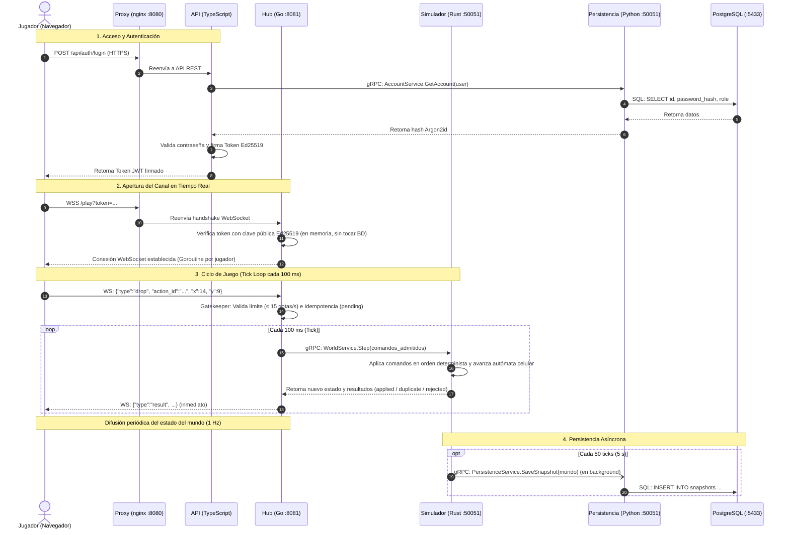

Listed directory hydrovalley
Viewed CLAUDE.md:1-144
Searched for "## D-"
Listed directory hydrovalley
Listed directory v1
Listed directory v1
Listed directory v1
Viewed documento-inicial.md:1-120
Searched for "## "
Viewed documento-inicial.md:600-750
Viewed documento-inicial.md:1100-1250
Viewed world.proto:1-60
Viewed play.proto:1-60
Viewed 02-componentes.puml:1-100
Viewed 03-secuencia-gota.puml:1-60
Viewed 09-secuencia-acceso.puml:1-60

El proyecto **Hydrovalley** es un juego incremental y cooperativo distribuido basado en las **3R del agua** (Reducir, Reutilizar y Reciclar), inspirado en mecánicas como *Drop and Grow*. Está concebido como un **sistema distribuido con arquitectura de microservicios políglota** (Go, Rust, TypeScript, Python) y **servidor autoritativo**, diseñado para desplegarse en contenedores Docker tanto de forma centralizada como repartida entre múltiples máquinas del laboratorio.

Toda la especificación técnica se encuentra documentada en [documento-inicial.md](file:///home/kobalt09/Documentos/GitHub/hydrovalley/docs/documento-inicial.md) y [CLAUDE.md](file:///home/kobalt09/Documentos/GitHub/hydrovalley/CLAUDE.md).

A continuación se detallan las funcionalidades, el procedimiento paso a paso mediante el cual se conectan las piezas y las interfaces utilizadas.

---

## 1. Funcionalidades del Proyecto

El sistema ofrece las siguientes capacidades funcionales y mecánicas de juego:

1. **Mundo compartido autoritativo (El Valle):**
   * Un valle isométrico de **32 × 32 casillas** compartido en tiempo real por todos los jugadores.
   * El mundo vive y evoluciona en el servidor mediante un **autómata celular** que avanza a un ritmo fijo de **10 ticks por segundo** (un tick cada 100 ms).
   * Estados de las casillas: *tierra seca → pasto → arbusto → flores → árbol*. La vegetación crece con la humedad y se evapora o marchita con el calor y el paso del tiempo.

2. **Mecánica de recursos y farmeo cooperativo:**
   * **Agua:** Cada jugador tiene un depósito personal (que se recarga con el tiempo) y gasta litros soltando gotas sobre las casillas para aumentar su humedad.
   * **Hojas:** Se obtienen cuando un jugador hace crecer una casilla a una etapa superior o combate incendios.
   * **Límite de clics (Rate Limiting):** Se restringe a un máximo de 15 gotas/s por jugador para frenar autoclickers.

3. **Instalaciones de las 3R (Automatización):**
   * Compradas con hojas para automatizar el riego:
     * **Aspersor de agua gris** (*Reutilizar*).
     * **Riego por goteo** (*Reducir*).
     * **Planta de tratamiento de aguas residuales** (*Reciclar*).
   * **Mejoras del jugador:** Aumento de capacidad del depósito y gotas de mayor volumen.

4. **Eventos dinámicos (Incendios):**
   * Fuego espontáneo que surge al azar en casillas secas con vegetación. Los jugadores deben cooperar soltando gotas para extinguirlo antes de que destruya la planta.

5. **Gestión de usuarios y sesión:**
   * Registro y autenticación mediante tokens asimétricos firmados (**Ed25519**).
   * Roles de usuario (`player` y `admin`). Comandos de administración para reiniciar el valle o activar modo demo.

6. **Métricas, Ranking y Reportes ecológicos:**
   * **Ranking global:** Jugadores que más hojas han aportado al valle.
   * **Reportes 3R:** Métricas calculadas sobre el ahorro, reutilización y reciclaje del agua a partir del historial.

7. **Chat multijugador:**
   * Mensajería en tiempo real entre jugadores ordenada lógicamente mediante números de secuencia.

8. **Tolerancia a fallos, Idempotencia y Consistencia:**
   * **Escritor único:** Solo el simulador en Rust muta el estado del mundo.
   * **Cero duplicados (Idempotencia):** Cada acción lleva un `action_id` (UUID). Reenvíos por caídas de red no duplican gastos de agua ni compras.
   * **Instantáneas periódicas:** Cada 50 ticks (5 segundos), el mundo se guarda asíncronamente en PostgreSQL sin bloquear el bucle de juego.
   * **Circuit Breaker:** Si el simulador falla, el Hub en Go pausa el valle, retiene comandos en cola y se recupera automáticamente al restablecerse el servicio.

---

## 2. Procedimiento de Conexión (Paso a Paso)

El flujo de extremo a extremo involucra un cliente ligero (Frontend en React + Phaser o Bots) y los servicios de backend:

### Detalle de las etapas:

1. **Procedimiento de Autenticación (`/api/auth`):**
   * El navegador envía credenciales al Proxy inverso (Nginx) en el puerto `8080`.
   * Nginx reenvía la petición al servicio **API (TypeScript)**.
   * La API calcula/valida el hash con **Argon2id**. Para consultar o guardar la cuenta, invoca por **gRPC** a `AccountService` en el servicio de **Persistencia (Python)**, que es el único con credenciales hacia **PostgreSQL**.
   * La API firma un token con su clave privada **Ed25519** (`player_id`, `username`, `role`, expiración de 12 horas) y lo entrega al cliente.

2. **Procedimiento de Conexión en Vivo (`/play`):**
   * El cliente abre un WebSocket seguro contra `wss://<host>:8080/play` adjuntando el token.
   * Nginx redirige el tráfico al **Hub (Go)** (puerto `8081`).
   * El Hub valida criptográficamente la firma del token con su clave pública Ed25519 en memoria, sin consultar a la API ni a la base de datos.
   * Se inicia una goroutine dedicada para la sesión del jugador.

3. **Procedimiento de Ejecución del Tick (Juego):**
   * El cliente envía acciones en JSON (ej. `drop`, `place_installation`) con un identificador único `action_id`.
   * El Hub actúa como **Gatekeeper**: comprueba duplicados en memoria (`pending`/`confirmed`) y aplica límite de frecuencia (máximo 15 gotas/s).
   * Cada 100 ms, el marcador de ticks del Hub toma todos los comandos admitidos y hace una llamada síncrona gRPC unaria `WorldService.Step()` hacia el **Simulador (Rust)**.
   * Rust ejecuta los comandos de forma estrictamente determinista (generador de números aleatorios con semilla guardada), avanza el mundo y devuelve el estado actualizado.
   * El Hub responde al jugador el estado de su acción (`applied`, `duplicate`, `rejected`) y periódicamente (1 Hz) difunde el estado consolidado a los clientes.

4. **Procedimiento de Respaldo e Instantáneas:**
   * Cada 50 ticks (5 s), Rust clona el estado en segundo plano y llama a `PersistenceService.SaveSnapshot` hacia Python. El hilo del tick **nunca se bloquea esperando a la base de datos**.

---

## 3. Interfaces de Comunicación

El sistema separa estrictamente las interfaces de borde (hacia clientes) de las interfaces internas entre microservicios, como se ilustra en el diagrama de componentes [02-componentes.puml](file:///home/kobalt09/Documentos/GitHub/hydrovalley/docs/diagrams/02-componentes.puml):

### A. Interfaces Externas (Borde / Cliente ↔ Servidor)

| Interfaz / Endpoint | Protocolo / Formato | Servicio Destino | Propósito |
| :--- | :--- | :--- | :--- |
| **`https://...:8080/`** | HTTPS | Nginx | Sirve la aplicación web estática (React + Phaser). |
| **`POST /api/auth/register`** **`POST /api/auth/login`** | HTTP/1.1 (JSON) | API (TypeScript) | Registro e inicio de sesión. Devuelve el token firmado Ed25519. Documentado en Swagger. |
| **`GET /api/catalog`** | HTTP/1.1 (JSON) | API (TypeScript) | Consulta de parámetros del juego, precios y balance. |
| **`GET /api/ranking`** **`GET /api/report`** | HTTP/1.1 (JSON) | API (TypeScript) | Tablas de clasificación y reportes de impacto ambiental. |
| **`GET /api/system`** | HTTP/1.1 (JSON) | API (TypeScript) | Estado de salud y métricas de los servicios. |
| **`wss://...:8080/play`** | WebSocket (JSON) | Hub (Go) | Canal bidireccional en tiempo real del juego. Contrato de mensajes tipado en [play.proto](file:///home/kobalt09/Documentos/GitHub/hydrovalley/proto/hydrovalley/play/v1/play.proto). |
| **`wss://...:8080/chat`** | WebSocket (JSON) | Chat (Go) | Mensajería instantánea entre jugadores. |

### B. Interfaces Internas (Microservicio ↔ Microservicio)

Se comunican mediante **gRPC sobre HTTP/2** utilizando **Protocol Buffers (`proto3`)**. **No se utilizan streams de gRPC**; todas las llamadas son de tipo unario (pregunta-respuesta) para evitar bloqueos y simplificar la integración entre lenguajes.

Los contratos se encuentran definidos en el directorio [proto/hydrovalley/](file:///home/kobalt09/Documentos/GitHub/hydrovalley/proto/hydrovalley/):

1. **`WorldService`** ([world.proto](file:///home/kobalt09/Documentos/GitHub/hydrovalley/proto/hydrovalley/world/v1/world.proto))
   * **Servidor:** Simulador en Rust (`:50051`) (o `world-go` como fallback).
   * **Clientes:** Hub (Go) y API (TypeScript).
   * **Métodos:**
     * `Step(StepRequest) returns (StepResponse)`: Envío en bloque de los comandos admitidos cada 100 ms y devolución del nuevo estado del mundo y resultados por acción.
     * `GetRanking(GetRankingRequest) returns (GetRankingResponse)`: Consulta del ranking por hojas ganadas.

2. **`PersistenceService`** ([persistence.proto](file:///home/kobalt09/Documentos/GitHub/hydrovalley/proto/hydrovalley/persistence/v1/persistence.proto))
   * **Servidor:** Persistencia en Python (`:50051`).
   * **Cliente:** Simulador en Rust.
   * **Métodos:**
     * `SaveSnapshot(SaveSnapshotRequest) returns (SaveSnapshotResponse)`: Guarda la instantánea del mundo (cada 5 s).
     * `LoadSnapshot(LoadSnapshotRequest) returns (LoadSnapshotResponse)`: Recupera la última instantánea al arrancar o tras recuperarse de una falla.

3. **`AccountService`** ([account.proto](file:///home/kobalt09/Documentos/GitHub/hydrovalley/proto/hydrovalley/persistence/v1/account.proto))
   * **Servidor:** Persistencia en Python.
   * **Cliente:** API (TypeScript).
   * **Métodos:**
     * `Register(RegisterRequest) returns (RegisterResponse)`: Inserta una cuenta con su hash Argon2id.
     * `GetAccount(GetAccountRequest) returns (GetAccountResponse)`: Obtiene credenciales para validar acceso.
     * `GetUsernames(GetUsernamesRequest) returns (GetUsernamesResponse)`: Mapea listas de IDs a nombres de usuario para complementar el ranking.

4. **`CatalogService`** ([catalog.proto](file:///home/kobalt09/Documentos/GitHub/hydrovalley/proto/hydrovalley/persistence/v1/catalog.proto))
   * **Servidor:** Persistencia en Python.
   * **Clientes:** API (TypeScript) y Simulador (Rust).
   * **Métodos:**
     * `GetCatalog(GetCatalogRequest) returns (GetCatalogResponse)`: Obtiene los valores de configuración de costos, duraciones y mejoras.

5. **`ReportService`** ([report.proto](file:///home/kobalt09/Documentos/GitHub/hydrovalley/proto/hydrovalley/persistence/v1/report.proto))
   * **Servidor:** Persistencia en Python.
   * **Cliente:** API (TypeScript).
   * **Métodos:**
     * `GetReport(GetReportRequest) returns (GetReportResponse)`: Estadísticas agregadas de las 3R.

6. **`ChatService`** ([chat.proto](file:///home/kobalt09/Documentos/GitHub/hydrovalley/proto/hydrovalley/chat/v1/chat.proto))
   * **Servidor:** Chat en Go (`:50051`).
   * **Clientes:** Hub (para avisos del sistema) y clientes web a través de la pasarela WebSocket del chat.
   * **Métodos:**
     * `SendMessage(SendMessageRequest) returns (SendMessageResponse)`
     * `ListMessages(ListMessagesRequest) returns (ListMessagesResponse)`

7. **Base de Datos (SQL)**
   * **Servidor:** PostgreSQL (`:5433` en el host / `:5432` en red interna).
   * **Cliente exclusivo:** Persistencia (Python). Ningún otro microservicio cuenta con credenciales de base de datos.
